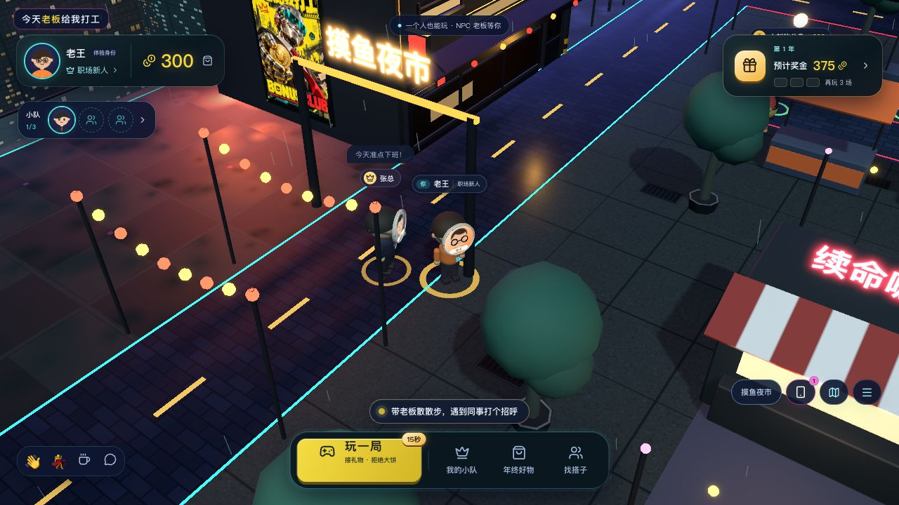

# 今天老板给我打工

**现实中我向你汇报，游戏里你给我打工。**

浏览器里的 3D 职场社交 RPG Demo。雇个老板、自由逛园区、和同事互动、玩小游戏，晋升领年终奖，再给自己和老板兑换道具。卡通赛博夜景园区扩为90×66米，包含广场、咖啡馆、人才街、小游戏俱乐部和露台，以及外围霓虹环街。



> 新一轮美术增加工业店面、金属设备、湿润路面、分区冷暖光和原创黄黑“老板递奖金”广告。实际前后对照、触屏和性能记录见 [夜之城方向美术验收](docs/REVIEW-NIGHT-CITY-ART.md)；此前的全系统风格记录见 [整体风格验收](docs/REVIEW-CYBER-CAMPUS.md)。

前端初版由本机 **Claude Code** 开发；用户授权后由 **Codex 接手续改本轮前端、实现Go服务端、验收并交付GitHub**。

## 前后端独立开发与内网接入

前端只需Node，后端只需Go。公网只连接假数据测试API；内网私有Go入口注入公司身份SPI，真实员工/密钥/数据库留在内网。相同前端产物通过 `runtime-config.json` 切换API，无需重新编译。

```sh
make dev-web   # 仅前端；API_PROXY_TARGET 指定测试API
make dev-api   # 仅Go API；独立测试数据库
make build-web # 静态前端产物
make build-api # 测试API二进制
make test-web  # 无需Go
make test-api  # 无需Node
```

完整流程、内网私有入口模板、浏览器SSO扩展、运行时配置和独立容器见 [前后端解耦与内网部署](docs/DECOUPLED-DEVELOPMENT.md)。`make up/stop/lan` 保留原有本地一键演示。

## 立即运行

需要 **Go 1.26+**、**Node.js 22.18+（含 npm）** 和 **Make**，支持 macOS / Linux。本机实际验证 Go 1.27.2、Node 25.9.0。

```sh
gh repo clone 1994/boss-works-for-me
cd boss-works-for-me
make up
```

访问 **http://localhost:8787**。`make up` 自动安装锁定版本依赖、构建前后端，并在后台启动一个 Go 进程提供页面和 API，默认监听 `0.0.0.0:8787`，支持局域网；健康检查成功后才提示就绪，同时打印监听、本机和局域网地址。直接运行 `make` 也一样。首次启动自动创建四个各有600金币的测试玩家，后续启动和重新部署保留数据。

```sh
make status    # 查看状态和访问地址
make logs      # 查看日志，Ctrl+C 退出日志查看，服务继续运行
make stop      # 停止服务，保留数据库（make down 也可用）
make restart   # 使用已有构建重启
git pull
make up        # 更新代码后重新构建并重启
```

同一 Wi-Fi / 有线局域网联机：

```sh
make lan       # 构建并后台启动，监听 0.0.0.0:8787
make status    # 再次查看本机地址和局域网地址
```

启动后会打印 `局域网访问：http://192.168.x.x:8787` 等本机网卡地址，将适用的地址发给同一网络下的同事即可。各自选择不同测试身份，就能在同一个园区相遇、聊天和互动，API 与实时同步共用同一地址。手机也可以打开；低端设备可在地址后加 `?lowfx=1`。若显示多个地址，选择当前 Wi-Fi / 有线网卡的地址。设备间需能互访；访客 Wi-Fi 的客户端隔离会阻止联机，系统防火墙弹窗时需允许本服务接收入站连接。

`make up`、`make lan`、`npm start` 和 `npm run start:binary` 都会显示API访问地址（默认API-only；传 `--static dist` 可托管已有前端），`make logs` 也能看到 Go 服务的地址列表。只绑定本机时会明确显示「局域网访问：未开启」；未检测到网卡或识别失败时会显示原因。更新 Go 二进制需先 `npm run build:server` 或执行 `make up`；`make restart` 仅运行已有构建。

`make up`、`make restart` 和 Go 程序默认绑定 `0.0.0.0`。已有 `.env` 或环境变量中的 `HOST=127.0.0.1` 仍会限制为本机访问，请改为 `HOST=0.0.0.0`，或直接运行 `make lan` 强制开启局域网。只需本机访问时可用 `HOST=127.0.0.1 make up`。修改端口可用 `PORT=9000 make lan`；也可复制 `.env.example` 为 `.env` 后修改配置。数据库默认位于 `data/boss.db`，日志和 PID 位于 `.run/`，均不提交 Git。

`make up` 的后台进程适合本地或单机 Demo，不会注册开机自启。更多命令用 `make help`。需要热更新开发时：

```sh
make stop
make dev       # Go API 8787 + Vite 5173，支持 http://localhost:5173 或 http://本机局域网IP:5173
```

也可以直接使用 npm 和编译产物：

```sh
npm run build
npm run start:binary -- --static dist
# 访问 http://127.0.0.1:8787
# 也可运行编译产物：./bin/boss-server --static dist
```

使用现代桌面浏览器及 WebGL。优先为桌面1440×900设计，也提供390×844手机布局。默认「自动」画质保留霓虹泛光、人物面具与电影演出；右下角「更多菜单 → 画质」可循环切换自动、清晰、流畅，选择会保存在当前浏览器。自动模式在持续掉帧时逐级降低像素与阴影预算，稳定后缓慢恢复；片头、弹窗和后台页面不参与判断。商店、手机和小游戏打开时，背后的园区按约30帧刷新，关闭后恢复正常刷新；试衣间的人物独立渲染。低端设备仍可在URL加 `?lowfx=1` 关闭后期效果和阴影。开发排查可加 `?perf=1` 显示最近5秒的帧率、帧时间与整帧绘制统计，默认不启用采样。性能对照与验证见 [第二轮优化与WASM对照](docs/REVIEW-PERFORMANCE-V2.md)及[首轮记录](docs/REVIEW-PERFORMANCE.md)。`make perf` 可复测碰撞和寻路；`make perf-wasm` 是独立的可选Rust/WASM实验，不影响一键部署。

本轮WAL并发读取、锁外并行广播、队员索引查询、事件合并与压缩资源的前后对照见 [前后端性能Review V3](docs/REVIEW-PERFORMANCE-V3.md)。目标服务器可用 `make perf-api BENCH_CPU=32` 复测；`/api/health`显示实际并发度和只读连接上限。

## Coding Agent 也能作为玩家

Claude Code / Codex 可以通过 Go CLI 操作普通玩家身份，和网页玩家一起招募、挖角、逛地图、玩小游戏、晋升和领年终奖。Agent 自己做策略，服务端复用同一套规则。

```sh
make build-cli
./bin/boss --profile claude login wang  # 仅 Demo 选人
./bin/boss --profile claude observe
./bin/boss --profile claude market
./bin/boss --profile claude watch 300   # 另一个终端保持在线，输出 NDJSON 事件
```

`make up` 也会编译 `bin/boss`。命令支持独立 profile、局域网/内网地址与 SSO SPI 凭证输入；完整命令、小游戏交互及 Agent 使用示例见 [Agent CLI](docs/AGENT-CLI.md)。

## 新版怎么玩

**雇个老板 → 玩几局 → 晋升领年终奖 → 买点喜欢的。**

1. 广场找到张总，或从「我的小队」雇佣。电脑用 WASD/方向键自由走，E 互动；手机用左下摇杆走动、右下情境键招募/挖角/碰杯/开玩，也能点击地面与地图步行。
2. 「玩一局」进入15秒「老板来接招」：礼物进圈按空格/点击，避开大饼。队伍技能真实生效。
3. 有命中的3局算一个演示年，发年终奖；成长达标可晋升，下个游戏年的基础奖金更高。
4. 「年终好物」买衬衫、眼镜和光环，给自己或老板3D试穿、穿戴。刷新保留，其他玩家也看得到。
5. 不同标签页选择不同身份，可互相走近、挥手、聊天、碰杯；本年碰杯为年终奖增加10%。

窄屏或触控设备自动显示双拇指操作区，横竖屏切换即时适配。打开手机、小游戏或弹窗会收起摇杆并停止移动，关闭后恢复。聊天入口可直接点开，输入后点发送；收起按钮或 Esc 返回移动，未发送草稿会保留。UI 与小游戏对齐验收见 [移动端验收](docs/REVIEW-UI-MOBILE.md)。

点右上角手机图标，或按 **P** 打开游戏内的 **BOSS OS**：玩一局、园区同事、消息盒子、我的小队、年终好物、晋升手册、园区地图与风云榜。小游戏、商店和成长面板关闭后会返回手机；「去找TA」和地图地点会收起手机并步行前往。打开手机暂停移动，Esc 返回桌面，再按一次收起。消息红点可在「消息盒子」全部标为已读。实机验收见 [手机系统](docs/REVIEW-PHONE.md)。

游戏已加入16种原创合成电子音效：按钮、手机、入场、脚步、开局、接礼物、失误、护盾、最后3秒倒计时、金币、签约、被挖角、年终奖、晋升、碰杯和换装。首次点击或按键后启用；「更多菜单 → 音效」可静音、调音量，刷新保留。登录页也有音效开关。切后台停止播放，返回后下一次操作恢复；不会补播积压声音。音效不加载外部音频文件。

人物现在佩戴带边框、侧绑带的头像面具。没有头像时显示名字肖像占位；接入用户 avatar 后，自己的角色、可雇佣分身、他人视角、3D试穿及界面头像会一致更新。头像接口与跨域图片要求见 [头像接入](docs/BACKEND.md#头像面具接入)。

电影片头已恢复为9秒的城市远景、办公室掠镜、霓虹电梯特写与玩家回场，支持跳过、Esc 和菜单里的「重播电影片头」。签约、挖角会自动聚焦实际角色，展示欢迎、收拾纸箱、离队和报到；拖动镜头、移动或「继续探索」会让出镜头控制。实机截图与验证见 [演出恢复记录](docs/REVIEW-CINEMA.md)。

新版已合并到 `main`。已有仓库更新：

```sh
git fetch origin
git switch main
git pull --ff-only
make up
```

[玩法规格](docs/COMMUNITY-MODE.md) / [V3实机验收](docs/REVIEW-V3.md) / [Go API](docs/BACKEND.md)。

当前只有一种单输入小游戏。双人小游戏、永久好友关系、老板数值养成、非独占分身收藏与借调尚未实现；原有三人队伍、签约、加价挖角与分红仍保留。人物位置为临时状态，服务重启回广场；金币、成长、年终奖、道具与穿戴由SQLite保存。

## 共享广场与附近人物

玩家在同一园区散步，服务端按距离同步附近位置，走到不同街道会遇见不同同事。近处保留头像面具和动作，中远处使用实例化简化人物；手机最多6位完整远端人物，桌面12位。手机名册仍可定位远处在线同事、按需展示员工分身。七位虚构NPC（两位空闲时沿街散步）和单人招募、小游戏、晋升、年终奖完整循环保留。

地图已扩为90×66米，新增夜市、天台、合影街与下班漫步道；张总仍在广场，Tony和小樱空闲时巡游。实现范围、截图和移动端验证见 [扩图验收](docs/REVIEW-CAMPUS-EXPANSION.md)。

距离阈值、100假玩家HTTP/SSE测试、300人CPU基准和实际网页证据见 [共享园区距离视野验收](docs/REVIEW-PROXIMITY.md)。`make test-crowd` / `make bench-crowd`只需Go；这些测试不等同于生产环境容量保证。

## 固定规则

| 项目 | Demo规则 |
| --- | --- |
| 初始金币 | 600 |
| 初签价 | 300 |
| 再次挖角 | `ceil(前成交价×1.25/10)×10`，300→380→480→600… |
| 转会补偿 | 原持有人获得新成交价90%，向下取整 |
| 分身分红 | 分身本人获得5%，向下取整 |
| 系统回收 | 剩余金额及舍入零头；初签无持有人时回收95% |
| 有效团队 | 最多3名；不能签约自己的分身或已持有的同事 |
| 挑战 | 基础15秒；技能可提高收益、延长时长、保护连击 |
| 多人同步 | SSE；正常网络下目标不超过3秒 |

测试玩家的分身被交易时，对应可登录账号真实收到5%；其他NPC的分红记在虚拟角色个人钱包。所有币仅为游戏积分。

## 验证与演示素材

```sh
npm test                 # Go测试、36组规则契约、地图互通与NPC巡游检查
npm run test:race         # Go竞态检测
npm run typecheck
npm run test:e2e          # 新版9项验收脚本，独立临时DB/8899端口
```

E2E默认使用本机Chrome；需要安装Chrome，或按Playwright配置切换浏览器。测试使用独立Go服务和临时数据库，不会重置8787上的普通预览。端口可用 `E2E_PORT` 调整。旧录屏脚本针对改造前UI，尚未适配本轮新交互；已有MP4仅作为初版留档。

- [V3 Codex 接手验收](docs/REVIEW-V3.md)：当前画面、年终奖、道具、晋升和双客户端真实操作。
- [初版 Codex 独立验收](docs/CODEX-REVIEW.md)：改造前的UI操作、交易金额与返工记录；本轮改版另见 [GAMEPLAY-V2](docs/GAMEPLAY-V2.md)。
- [服务端说明与API](docs/BACKEND.md)：事务、项目计时、SSE、部署和边界。
- [验收参考配置](docs/game-config.json)：经济参数；实际规则以代码为准。
- [旧版办公室演示内容与录制说明](docs/DEMO.md)（改造前版本）。
- 旧版演示：[双玩家MP4](artifacts/demo/boss-demo-2p.mp4) / [单人清晰版MP4](artifacts/demo/boss-demo-player-A.mp4)，未包含本轮自由探索改版。
- [功能与视觉验收清单](docs/ACCEPTANCE.md) / [美术素材与许可](docs/ASSETS.md)。
- [截图](artifacts/screenshots)：入场、入职、收拾纸箱、离职、奖励、分红、消息与手机界面。
- [独立UI账本核对](artifacts/verification/independent-ui.json)。

## 技术与部署

React + TypeScript + Three.js / React Three Fiber，Go `net/http` + SQLite（纯Go驱动）+ SSE。3D角色、家具、建筑和贴图由代码生成，不依赖未授权模型或付费素材，启动不需要外部美术CDN。

```sh
docker build -t boss-demo .
docker run --rm -p 8787:8787 -v boss-demo-data:/data boss-demo
```

本机没有Docker，因此镜像构建尚未实际验收；原生Go编译和运行已验证。当前部署支持一个Go服务进程，代理需要关闭SSE缓冲。数据库和密钥配置不会提交Git。环境变量见 `.env.example`。

```sh
npm run seed     # 仅在没有数据时初始化，保留现有数据
# 停止演示服务后重置，清空该演示数据库：
npm run reset
```

## Demo范围

身份认证已抽成独立 Go SPI，支持注入公司适配器、本地 Mock 和统一登录接口，接入说明见 [身份 / SSO SPI](docs/IDENTITY-SPI.md)。运行 `make test-auth` 可独立验证身份接口，不依赖 Node 或真实 SSO。

**未接公司SSO**，登录页明确标识预置测试身份。当前未实现生产身份授权、强反机器人/反作弊、多实例通知总线或生产压测。服务端验证时间、任务ID、重复操作并自行算奖励，但不应将这版演示的操作记录校验宣传为生产级反作弊。

代码采用MIT许可；第三方依赖保留各自许可。详细美术和依赖说明随交付记录提供。
