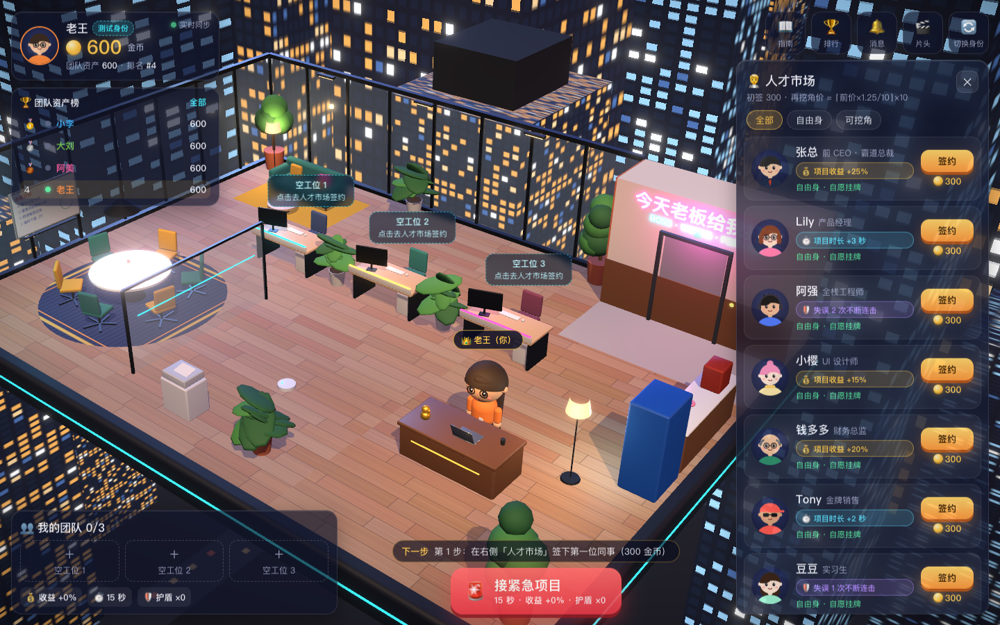

# 今天老板给我打工

**现实中我向你汇报，游戏里你给我打工。**

浏览器里的 3D 职场社交经营 RPG Demo。接15秒紧急项目赚钱、招募虚拟同事、激活团队技能、加价挖走别人团队的人。完整微缩办公室包含玻璃幕墙、城市夜景、霓虹电梯、卡通人物、工位、会议区和休息区。



前端由本机 **Claude Code** 开发；**Codex 实现 Go 服务端、协调、独立验收和 GitHub 交付**。

## 立即运行

需要 **Go 1.26+**、**Node.js 22.18+（含 npm）** 和 **Make**，支持 macOS / Linux。本机实际验证 Go 1.27.2、Node 25.9.0。

```sh
gh repo clone 1994/boss-works-for-me
cd boss-works-for-me
make up
```

访问 **http://localhost:8787**。`make up` 自动安装锁定版本依赖、构建前后端，并在后台启动一个 Go 进程提供页面和 API；健康检查成功后才提示就绪。直接运行 `make` 也一样。首次启动自动创建四个各有600金币的测试玩家，后续启动和重新部署保留数据。

```sh
make status    # 查看状态和访问地址
make logs      # 查看日志，Ctrl+C 退出日志查看，服务继续运行
make down      # 停止服务，保留数据库
make restart   # 使用已有构建重启
git pull
make up        # 更新代码后重新构建并重启
```

默认只允许本机访问。如需局域网内其他设备访问，可以运行 `HOST=0.0.0.0 make up`，然后打开 `http://这台机器的IP:8787`。修改端口可用 `PORT=9000 make up`；也可复制 `.env.example` 为 `.env` 后修改配置。数据库默认位于 `data/boss.db`，日志和 PID 位于 `.run/`，均不提交 Git。

`make up` 的后台进程适合本地或单机 Demo，不会注册开机自启。更多命令用 `make help`。需要热更新开发时：

```sh
make down
make dev       # Go API 8787 + Vite 5173，浏览器访问 http://localhost:5173
```

也可以直接使用 npm 和编译产物：

```sh
npm run build
npm run start:binary
# 访问 http://127.0.0.1:8787
# 也可运行编译产物：./bin/boss-server
```

使用现代桌面浏览器及 WebGL。优先为桌面1440×900设计，也提供390×844手机布局。低端设备可在URL加 `?lowfx=1` 关闭后期效果和阴影；正式画面默认启用完整效果。

## 三分钟双玩家验收

开两个独立标签页，分别登录「老王」A和「小李」B。身份保存在各自标签页的 `sessionStorage` 中，金币/团队/消息都保存在服务端SQLite。也可用普通与无痕窗口、不同浏览器或共享同一服务器的两台设备。

1. A以300签约「张总」，余额300。市场自动收起，观看电梯开门、走到工位、坐下庆祝，收益技能+25%。
2. B应实时看到张总属于A，点击380挖角。B剩220；A获342补偿、余额642。观看A端起身、收拾纸箱、走向电梯离场，以及B端重新入职。
3. B接15秒「紧急项目」，点击📧🐞📅📊，避免🥧。带张总+25%加成，至少完成8个有效任务即可赚到至少80，余额达到300以上。
4. B花300签约「老王(分身)」。A收到15分红，余额657；消息中心与排行榜同步更新。
5. A可花480把张总挖回来，继续循环。也可以分别招募时间/护盾技能同事，再接项目感受增益。

所有确认弹窗均列出扣款和分账。签约、挖角、技能、排行榜、消息都使用真实服务端状态。点击「片头」可重播入场镜头，支持跳过。

## 固定规则

| 项目 | Demo规则 |
| --- | --- |
| 初始金币 | 600 |
| 初签价 | 300 |
| 再次挖角 | `ceil(前成交价×1.25/10)×10`，300→380→480→600… |
| 转会补偿 | 原持有人获得新成交价90%，向下取整 |
| 分身分红 | 分身本人获得5%，向下取整 |
| 系统回收 | 剩余金额及舍入零头；初签无持有人时回收95% |
| 有效团队 | 最多3名；不能签约自己的分身或已持有的同事 |
| 挑战 | 基础15秒；技能可提高收益、延长时长、保护连击 |
| 多人同步 | SSE；正常网络下目标不超过3秒 |

测试玩家的分身被交易时，对应可登录账号真实收到5%；其他NPC的分红记在虚拟角色个人钱包。所有币仅为游戏积分。

## 验证与演示素材

```sh
npm test                 # Go测试 + 当前TS规则与36组契约样例对照
npm run test:race         # Go竞态检测
npm run typecheck
npm run test:e2e          # 构建后，用独立临时DB/8899端口跑真实浏览器测试
npx playwright install ffmpeg # 首次录制安装Playwright视频工具
npm run demo:record      # 录制真实网页演示
```

E2E默认使用本机Chrome；需要安装Chrome，或按Playwright配置切换浏览器。测试使用独立Go服务和临时数据库，不会重置8787上的普通预览。端口可用 `E2E_PORT` 调整。录制需要 ffmpeg。

- [Codex独立验收](docs/CODEX-REVIEW.md)：实际UI操作、交易金额、返工问题和复核结果。
- [服务端说明与API](docs/BACKEND.md)：事务、项目计时、SSE、部署和边界。
- [验收参考配置](docs/game-config.json)：经济参数；实际规则以代码为准。
- [演示内容与录制说明](docs/DEMO.md)。
- [双玩家演示MP4](artifacts/demo/boss-demo-2p.mp4) / [单人清晰版MP4](artifacts/demo/boss-demo-player-A.mp4)。
- [功能与视觉验收清单](docs/ACCEPTANCE.md) / [美术素材与许可](docs/ASSETS.md)。
- [截图](artifacts/screenshots)：入场、入职、收拾纸箱、离职、奖励、分红、消息与手机界面。
- [独立UI账本核对](artifacts/verification/independent-ui.json)。

## 技术与部署

React + TypeScript + Three.js / React Three Fiber，Go `net/http` + SQLite（纯Go驱动）+ SSE。3D角色、家具、建筑和贴图由代码生成，不依赖未授权模型或付费素材，启动不需要外部美术CDN。

```sh
docker build -t boss-demo .
docker run --rm -p 8787:8787 -v boss-demo-data:/data boss-demo
```

本机没有Docker，因此镜像构建尚未实际验收；原生Go编译和运行已验证。当前部署支持一个Go服务进程，代理需要关闭SSE缓冲。数据库和密钥配置不会提交Git。环境变量见 `.env.example`。

```sh
npm run seed     # 仅在没有数据时初始化，保留现有数据
# 停止演示服务后重置，清空该演示数据库：
npm run reset
```

## Demo范围

**未接公司SSO**，登录页明确标识预置测试身份。当前未实现生产身份授权、强反机器人/反作弊、多实例通知总线或生产压测。服务端验证时间、任务ID、重复操作并自行算奖励，但不应将这版演示的操作记录校验宣传为生产级反作弊。

代码采用MIT许可；第三方依赖保留各自许可。详细美术和依赖说明随交付记录提供。
