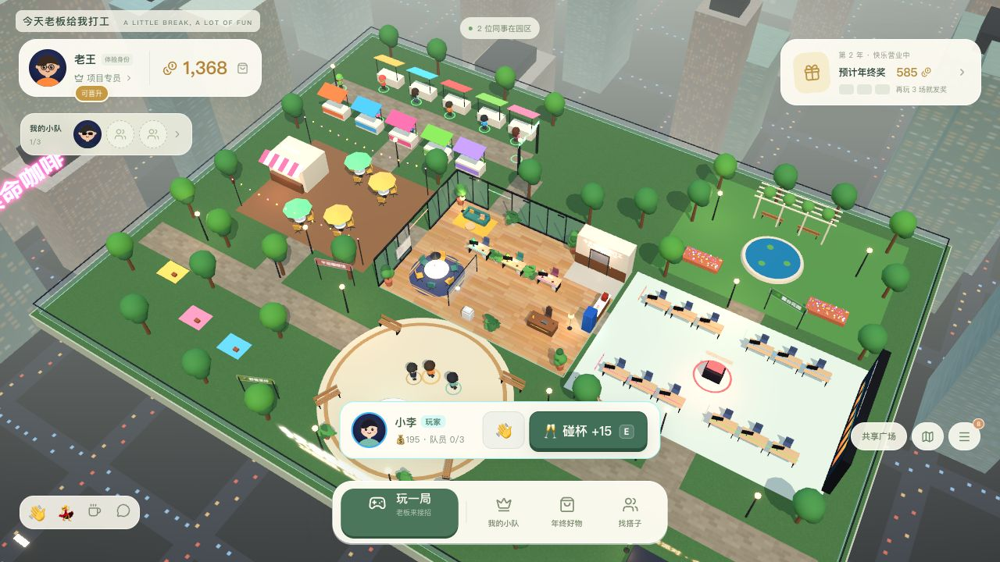

# 今天老板给我打工

**现实中我向你汇报，游戏里你给我打工。**

浏览器里的 3D 职场社交 RPG Demo。雇个老板、自由逛园区、和同事互动、玩小游戏，晋升领年终奖，再给自己和老板兑换道具。白天微缩园区包含广场、咖啡馆、人才街、小游戏俱乐部和露台。



> 本轮已修复地面遮挡并接入晋升、年终奖、3D试穿与道具持久化。实机过程与开发边界见 [V3验收](docs/REVIEW-V3.md)。

前端初版由本机 **Claude Code** 开发；用户授权后由 **Codex 接手续改本轮前端、实现Go服务端、验收并交付GitHub**。

## 立即运行

需要 **Go 1.26+**、**Node.js 22.18+（含 npm）** 和 **Make**，支持 macOS / Linux。本机实际验证 Go 1.27.2、Node 25.9.0。

```sh
gh repo clone 1994/boss-works-for-me
cd boss-works-for-me
make up
```

访问 **http://localhost:8787**。`make up` 自动安装锁定版本依赖、构建前后端，并在后台启动一个 Go 进程提供页面和 API；健康检查成功后才提示就绪。直接运行 `make` 也一样。首次启动自动创建四个各有600金币的测试玩家，后续启动和重新部署保留数据。

```sh
make status    # 查看状态和访问地址
make logs      # 查看日志，Ctrl+C 退出日志查看，服务继续运行
make stop      # 停止服务，保留数据库（make down 也可用）
make restart   # 使用已有构建重启
git pull
make up        # 更新代码后重新构建并重启
```

同一 Wi-Fi / 有线局域网联机：

```sh
make lan       # 构建并后台启动，监听 0.0.0.0:8787
make status    # 再次查看本机地址和局域网地址
```

启动后会打印 `局域网访问：http://192.168.x.x:8787` 等本机网卡地址，将适用的地址发给同一网络下的同事即可。各自选择不同测试身份，就能在同一个园区相遇、聊天和互动，API 与实时同步共用同一地址。手机也可以打开；低端设备可在地址后加 `?lowfx=1`。若显示多个地址，选择当前 Wi-Fi / 有线网卡的地址。设备间需能互访；访客 Wi-Fi 的客户端隔离会阻止联机，系统防火墙弹窗时需允许本服务接收入站连接。

`make lan` 会覆盖 `.env` 的 HOST 设置；默认 `make up` 仍仅本机访问，也可用 `HOST=0.0.0.0 make up`。修改端口可用 `PORT=9000 make lan`；也可复制 `.env.example` 为 `.env` 后修改配置。数据库默认位于 `data/boss.db`，日志和 PID 位于 `.run/`，均不提交 Git。

`make up` 的后台进程适合本地或单机 Demo，不会注册开机自启。更多命令用 `make help`。需要热更新开发时：

```sh
make stop
make dev       # Go API 8787 + Vite 5173，浏览器访问 http://localhost:5173
```

也可以直接使用 npm 和编译产物：

```sh
npm run build
npm run start:binary
# 访问 http://127.0.0.1:8787
# 也可运行编译产物：./bin/boss-server
```

使用现代桌面浏览器及 WebGL。优先为桌面1440×900设计，也提供390×844手机布局。低端设备可在URL加 `?lowfx=1` 关闭后期效果和阴影；正式画面默认启用完整效果。

## 新版怎么玩

**雇个老板 → 玩几局 → 晋升领年终奖 → 买点喜欢的。**

1. 广场找到张总，或从「我的小队」雇佣。WASD/方向键自由走，也能点击地面与地图步行。
2. 「玩一局」进入15秒「老板来接招」：礼物进圈按空格/点击，避开大饼。队伍技能真实生效。
3. 有命中的3局算一个演示年，发年终奖；成长达标可晋升，下个游戏年的基础奖金更高。
4. 「年终好物」买衬衫、眼镜和光环，给自己或老板3D试穿、穿戴。刷新保留，其他玩家也看得到。
5. 不同标签页选择不同身份，可互相走近、挥手、聊天、碰杯；本年碰杯为年终奖增加10%。

新版已合并到 `main`。已有仓库更新：

```sh
git fetch origin
git switch main
git pull --ff-only
make up
```

[玩法规格](docs/COMMUNITY-MODE.md) / [V3实机验收](docs/REVIEW-V3.md) / [Go API](docs/BACKEND.md)。

当前只有一种单输入小游戏。双人小游戏、永久好友关系、老板数值养成、非独占分身收藏与借调尚未实现；原有三人队伍、签约、加价挖角与分红仍保留。人物位置为临时状态，服务重启回广场；金币、成长、年终奖、道具与穿戴由SQLite保存。

## 固定规则

| 项目 | Demo规则 |
| --- | --- |
| 初始金币 | 600 |
| 初签价 | 300 |
| 再次挖角 | `ceil(前成交价×1.25/10)×10`，300→380→480→600… |
| 转会补偿 | 原持有人获得新成交价90%，向下取整 |
| 分身分红 | 分身本人获得5%，向下取整 |
| 系统回收 | 剩余金额及舍入零头；初签无持有人时回收95% |
| 有效团队 | 最多3名；不能签约自己的分身或已持有的同事 |
| 挑战 | 基础15秒；技能可提高收益、延长时长、保护连击 |
| 多人同步 | SSE；正常网络下目标不超过3秒 |

测试玩家的分身被交易时，对应可登录账号真实收到5%；其他NPC的分红记在虚拟角色个人钱包。所有币仅为游戏积分。

## 验证与演示素材

```sh
npm test                 # 31项Go测试 + 36组规则契约 + 72条地图路径
npm run test:race         # Go竞态检测
npm run typecheck
npm run test:e2e          # 新版8项验收脚本，独立临时DB/8899端口
```

E2E默认使用本机Chrome；需要安装Chrome，或按Playwright配置切换浏览器。测试使用独立Go服务和临时数据库，不会重置8787上的普通预览。端口可用 `E2E_PORT` 调整。旧录屏脚本针对改造前UI，尚未适配本轮新交互；已有MP4仅作为初版留档。

- [V3 Codex 接手验收](docs/REVIEW-V3.md)：当前画面、年终奖、道具、晋升和双客户端真实操作。
- [初版 Codex 独立验收](docs/CODEX-REVIEW.md)：改造前的UI操作、交易金额与返工记录；本轮改版另见 [GAMEPLAY-V2](docs/GAMEPLAY-V2.md)。
- [服务端说明与API](docs/BACKEND.md)：事务、项目计时、SSE、部署和边界。
- [验收参考配置](docs/game-config.json)：经济参数；实际规则以代码为准。
- [旧版办公室演示内容与录制说明](docs/DEMO.md)（改造前版本）。
- 旧版演示：[双玩家MP4](artifacts/demo/boss-demo-2p.mp4) / [单人清晰版MP4](artifacts/demo/boss-demo-player-A.mp4)，未包含本轮自由探索改版。
- [功能与视觉验收清单](docs/ACCEPTANCE.md) / [美术素材与许可](docs/ASSETS.md)。
- [截图](artifacts/screenshots)：入场、入职、收拾纸箱、离职、奖励、分红、消息与手机界面。
- [独立UI账本核对](artifacts/verification/independent-ui.json)。

## 技术与部署

React + TypeScript + Three.js / React Three Fiber，Go `net/http` + SQLite（纯Go驱动）+ SSE。3D角色、家具、建筑和贴图由代码生成，不依赖未授权模型或付费素材，启动不需要外部美术CDN。

```sh
docker build -t boss-demo .
docker run --rm -p 8787:8787 -v boss-demo-data:/data boss-demo
```

本机没有Docker，因此镜像构建尚未实际验收；原生Go编译和运行已验证。当前部署支持一个Go服务进程，代理需要关闭SSE缓冲。数据库和密钥配置不会提交Git。环境变量见 `.env.example`。

```sh
npm run seed     # 仅在没有数据时初始化，保留现有数据
# 停止演示服务后重置，清空该演示数据库：
npm run reset
```

## Demo范围

**未接公司SSO**，登录页明确标识预置测试身份。当前未实现生产身份授权、强反机器人/反作弊、多实例通知总线或生产压测。服务端验证时间、任务ID、重复操作并自行算奖励，但不应将这版演示的操作记录校验宣传为生产级反作弊。

代码采用MIT许可；第三方依赖保留各自许可。详细美术和依赖说明随交付记录提供。
