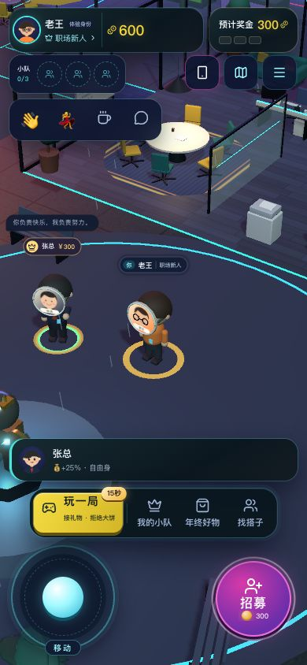
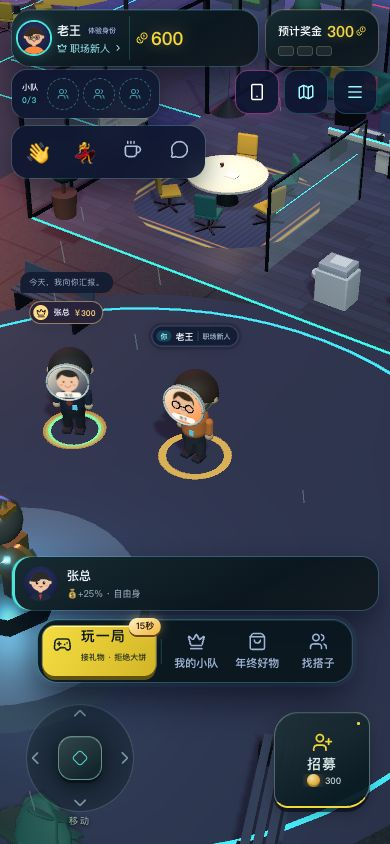
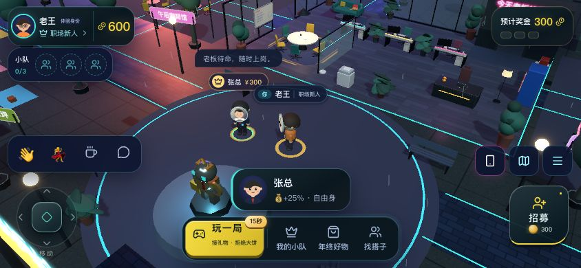
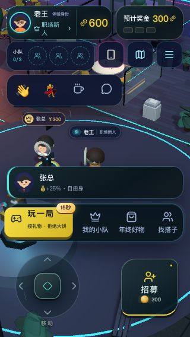

# 移动操控区精简

2026-10-20，隔离测试服务8806，独立假数据；原有8787服务未重启。

1. **竖屏外观：通过。** 旧摇杆的亮蓝球、多层光环和标签底板被替换为半透明底盘、细方向刻度、哑光拇指钮；按住时方向提示变黄。右侧互动键同步改成暗色工业面板，以图标和下沿颜色表达招募、挖角、开玩等状态，移除循环扩散光圈。
2. **操控：通过。** 在390×844视口分别按住摇杆两侧800 ms，人物离开/返回招募范围；松手后`data-active`清除，拇指钮恢复`translate3d(0px, 0px, 0px)`。实际触摸区域仍为132×132，拇指钮视觉缩为44×44。点击招募键正常打开确认框，取消正常；此次未交易。输入、死区、指针捕获和停止逻辑未改。
3. **布局：通过。** 390×844、844×390、320×568无文档溢出；横屏摇杆112×112、互动键86×86，均在视口内；320窄屏摇杆132×132、互动键96×96，均在视口内。恢复桌面后触屏控件消失。

生产构建及TypeScript检查：`npm run build:web -- --outDir .run/art-web`通过。本轮仅CSS与装饰SVG变更，未新增运行依赖或逐帧更新。

限制：使用本机浏览器模拟视口和指针操作，未进行实体手机、多指同时操作或完整可访问性合规测试。

改前：

改后：

