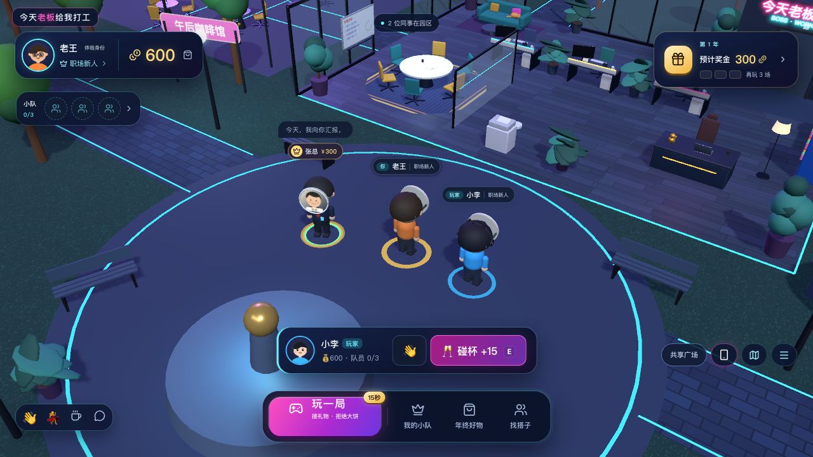
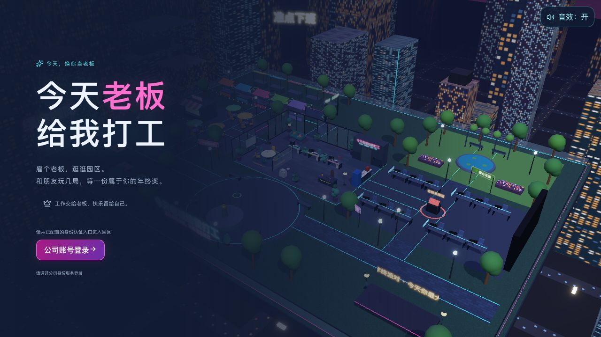
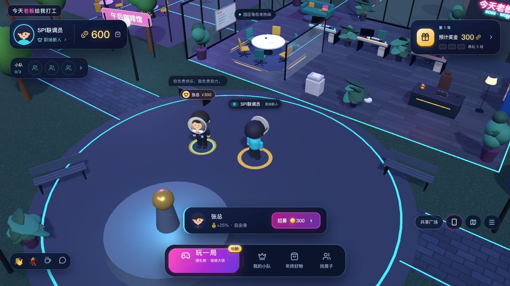

# 公网前端、测试服务与内网真实环境

## 边界

保持一个公共核心仓库，构建、进程和配置独立。公司适配器另放内网私有 Go module，不修改公共核心。这里的 Demo / Mock、fixture、数据库、截图都只属于测试环境。

```text
公网开发： React / Three.js ──HTTP + SSE──> 测试 API ──> 假身份 + 测试 SQLite
                                             不连接公司系统

内网部署： 同一份 dist ──内网网关 /api──> 私有 Go 入口 ──> 公共 server / backend
                                              └──────> 公司 identity SPI / SSO
```

前端产物可在公网构建，再同步进内网静态服务。浏览器必须能访问它配置的 API；公网网页无法凭这次拆分穿透内网。真实部署推荐**前端静态产物和 API 通过内网同一域名的网关提供**。公网协作始终使用测试 API 和假资料。CORS 不提供网络穿透，也不替代鉴权。

| 路径 | 职责 | 工具链 |
| --- | --- | --- |
| `src/`, `public/`, `shared/` | 前端、API 客户端、展示规则与 DTO | Node；无需 Go |
| `contracts/` | 双方共有的 HTTP 边界说明与计分契约样例 | 随两端一起版本化 |
| `backend/` | 游戏事务、SQLite、HTTP 与 SSE | Go；无需 Node / dist |
| `identity/` | 身份 SPI、测试 Mock | Go；无公司 SDK |
| `server/` | 环境校验、数据库模式、CORS、HTTP 生命周期 | Go；私有入口直接复用 |
| `cmd/boss-server/` | 公网测试 / 本地演示启动器 | Go；只提供 demo/mock |
| 内网私有 module | 公司 SDK、密钥读取、身份适配器、实际启动入口 | 由内网开发维护 |

Go 不导入 TypeScript，前端不读取后端实现文件。相同的规则通过 `contracts/rules-contract.json` 同时校验，服务端仍负责实际算钱、鉴权和归属事务。

## 公网前端独立开发

只安装 Node 22.18+：

```sh
npm ci
API_PROXY_TARGET=https://boss-test.example.com make dev-web
# 浏览器打开 Vite 地址；/api 由开发代理转发到假数据测试服务
make test-web
make build-web
make package-web  # .run/boss-web.tar.gz；仅 dist 内容
```

`API_PROXY_TARGET` 只影响 Vite 开发代理，不打包给浏览器。不要把真实内网凭证放进 `VITE_*`、源码或前端 JSON。前端没有在断线时假造成功的逻辑，测试后端也执行真实游戏事务。

### 同一份前端产物切换环境

编辑部署产物根目录 `runtime-config.json`，不需要重新编译 JS：

```json
{ "apiBaseUrl": "" }
```

空串使用当前域名 `/api/*`，适合开发代理和内网同域网关。直连独立测试 API：

```json
{ "apiBaseUrl": "https://boss-test.example.com" }
```

若网关有前缀，也可用 `/boss-service` 或 `https://test.example.com/boss-service`；后端真实路径仍为 `/api/*`，由网关去掉前缀。REST 与 SSE 使用相同 base，会话按 base 隔离。JSON **不含 `/api` 后缀、不放 token/密码**。该文件启动时以 `no-store` 加载；部署/CDN也必须禁止缓存它，未找到或非法时会明确报错，不悄悄改连其他环境。完整刷新后切换。

跨源时测试 API 显式配置 `CORS_ALLOWED_ORIGINS=https://web-test.example.com`，多个来源逗号分隔，不接受 `*`。HTTPS 页面需使用可达的 HTTPS API。请求只使用游戏 Bearer token，不依赖跨站 Cookie。

## 后端独立开发与测试

只安装 Go 1.26+：

```sh
make test-api
make build-api
PORT=8790 make dev-api
# API-only；独立 data/boss-test.db；不会重启 make up 的服务
curl http://127.0.0.1:8790/api/health
```

`make dev-api` 前台运行，Ctrl+C 停止；`make stop` 继续用于 `make up` 管理的后台演示。默认 CLI 只提供 API，不要求 `dist`。`make up` 保留原有前后端一键构建、后台管理、局域网地址和静态页面行为。

Mock 凭证联调见 [身份 SPI](IDENTITY-SPI.md)。只接受 fixture 内假 token，Mock 不代表真实 SSO。参考 `deploy/api/test.env.example`，启动时由部署平台导出环境变量。

## 内网私有接入

1. `make package-api` 导出 `.run/boss-api-source.tar.gz`，内容只有 Go 核心、契约、模板与接入文档，没有 Node 依赖、前端包、数据库、`.env`、`.run` 或真实配置。解压到内网 `boss-core/`。
2. 新建相邻内网私有 module，把 `examples/intranet/go.mod.template`、`main.go.template` 分别复制为 `go.mod`、`main.go`。`replace ... => ../boss-core` 用本地核心源码；更新只需替换核心目录，私有适配器不会被覆盖。也可由内网 Git 镜像/GOPROXY固定公共核心版本。隔离网络的 Go 依赖需通过内网 GOPROXY或预先同步 vendor/module cache 准备；源码包不包含依赖缓存。
3. 在私有 `companyidentity` 包实现：

```go
// 必须实现；凭证验证完成后返回可信的 subject/name/title/avatarURL。
ID() string
Authenticate(context.Context, identity.Credentials) (identity.User, error)

// 浏览器 SSO 使用这个可选扩展；网页会自动出现“公司账号登录”。
BeginLogin(ctx context.Context, callbackURL string) (identity.BrowserLogin, error)
```

适配器实现 `identity.BrowserProvider` 后，公共前端通过 `/api/auth/browser` 获取跳转地址。SSO 回跳到固定 `LOGIN_CALLBACK_URL`，携带 `code`、`state`；网页先匹配当前标签页保存的state、清理地址栏，再把它们交给 `/api/auth/login`。**state、nonce、PKCE、授权码单次消费、issuer/audience/签名/有效期、员工准入权限由内网适配器实施**，核心不虚构任何公司协议。该流程的发起与验证必须共享可靠的一次性状态存储，并校验回调地址；不能只返回一个未验证的用户。只实现基础 Provider 时，可由内网已有登录壳调用通用登录函数，但网页不会凭空显示可用的SSO按钮。

4. 导出 `deploy/api/production.env.example` 所列配置和私有适配器所需密钥，编译并运行私有入口：

```sh
cd boss-service
# 确保 GOPROXY / 依赖缓存已就绪
go mod tidy
CGO_ENABLED=0 go build -trimpath -o boss-service .
APP_ENV=production DB_PATH=/data/boss-production.db \
LOGIN_CALLBACK_URL='https://game.example.internal/?boss_auth=callback' ./boss-service
```

`.env.example` 不会被私有入口自动读取；由部署工具注入环境变量。模板只组装公共 `server.ConfigFromEnv()`、公司 provider 和 `server.Run()`。标准 Demo CLI不支持 `AUTH_MODE=sso`，避免“改个开关就误以为接好SSO”。

5. 将前端 `dist` 部署到内网静态服务，保留 `apiBaseUrl:""`，网关 `/api/*` 反代内网 Go 服务。配置示例 `deploy/web/default.conf.template`；也可直连内网独立 API 并配置精确 CORS 白名单。SSO授权端还需登记上述精确回调地址。

### 正式环境的数据边界

`APP_ENV=production` 必须注入非 demo/mock provider，初始化失败停止启动；不允许开启演示重置。新库只创建7个虚构NPC，**不会创建四个演示员工账号或其分身**；真实员工在SPI首次验证成功后事务性创建。真实头衔仍只是展示，不自动改变游戏职级。

生产启动拒绝带有演示/Mock身份记录、旧版演示玩家或测试标记的数据库；测试启动也拒绝正式标记的数据库。不会自动清库或迁移测试玩家成正式员工。正式环境应使用新数据库路径，后续重启保留真实资产。底层正式 Game 的 `Reset()` 同样拒绝演示重置。

公司SDK、密钥、员工目录和真实数据库留在内网私有项目/密钥管理系统，不回传此仓库。头像需是员工浏览器可访问的内网HTTPS地址，并满足 WebGL 图片跨域要求。

## 容器

- `deploy/web/Dockerfile`：Node构建、Nginx静态服务，不需要Go。运行时挂载只读 `runtime-config.json`；同域代理上游用 `API_UPSTREAM` 配置。
- `deploy/api/Dockerfile`：只用Go构建的**测试API镜像**，没有前端文件。正式镜像应在内网私有module构建其入口，复用同样的运行阶段。
- 根 `Dockerfile`：保留一体化演示镜像，修复身份/组装包缺少COPY的问题。

```sh
docker build -f deploy/api/Dockerfile -t boss-api-test .
docker build -f deploy/web/Dockerfile -t boss-web .
# 示例假数据独立服务，同一个Docker网络，供Nginx按服务名访问
docker network create boss-test
docker run -d --name boss-api --network boss-test -v boss-test-data:/data boss-api-test
docker run -d --name boss-web --network boss-test -p 8080:80 boss-web
```

SSE 代理必须关闭buffering/cache并保持长连接。原生EventSource沿用游戏会话query参数；代理日志不要记录查询字符串。示例Nginx已使用不含query的日志格式。正式服务仍为单进程SQLite+内存园区/SSE，不是多实例集群；扩容、SSO注销/撤销和会话到期策略按真实上线要求在内网补齐。

## 本轮验收（2026-10-20）

- `npm run test:web`、生产前端构建、`go test -race ./...`、`go vet ./...`通过。
- 新增接口测试覆盖正式模式配置拒绝、测试/正式库隔离（含无标记旧演示库）、真实事务式首登、正式Reset拒绝、精确CORS预检/错误响应、跨源SSE hello、固定回调与适配器单次code消费、上游错误不泄漏。
- 浏览器静态站5178直连独立8801测试API：两位假玩家真实登录、SSE在线同步，运行时无错误。
- 同一前端构建只改runtime-config.json指向8802，使用**本地假SPI**运行production模式：公司登录按钮→发起跳转→匹配标签页state→code换游戏会话→园区及600初始金币；地址栏code/state已清理，正式界面没有“体验身份”。未经当前标签页发起的回调被拒绝。没有连接真实公司SSO。
- `make package-api`的源码包在独立临时目录运行Go测试通过；私有module模板+本地编译用适配器亦独立编译成功，不需要Node或前端文件。
- `npm run test:deployment`在独立临时目录实际验证原有后台控制器：构建、启动、静态托管、健康检查、状态、停止和保留数据库。原8787服务与数据未被重启或重置。
- 本机无Docker，三份Dockerfile和Nginx配置仅完成源码审阅，没有声称镜像已构建/运行；上面的原生命令已实测。




