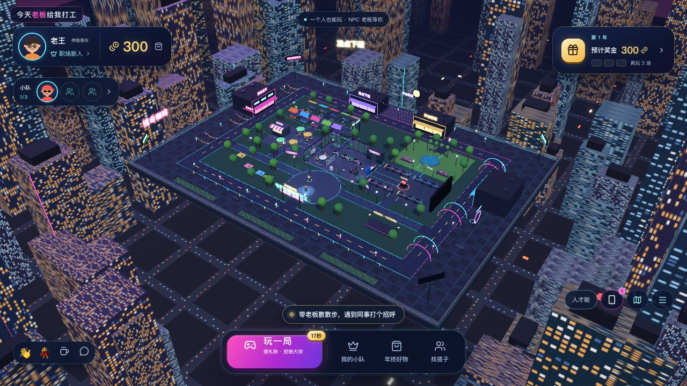
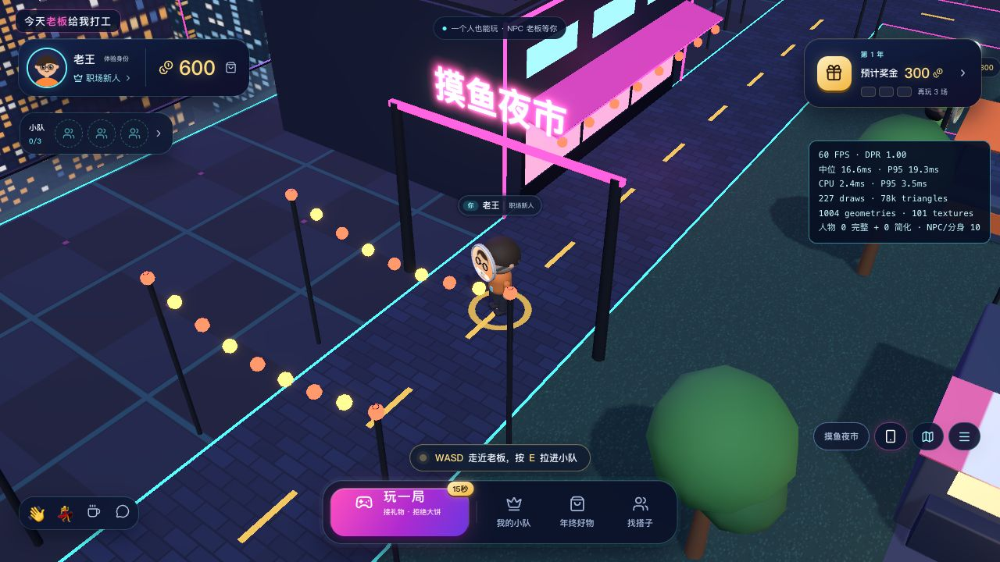
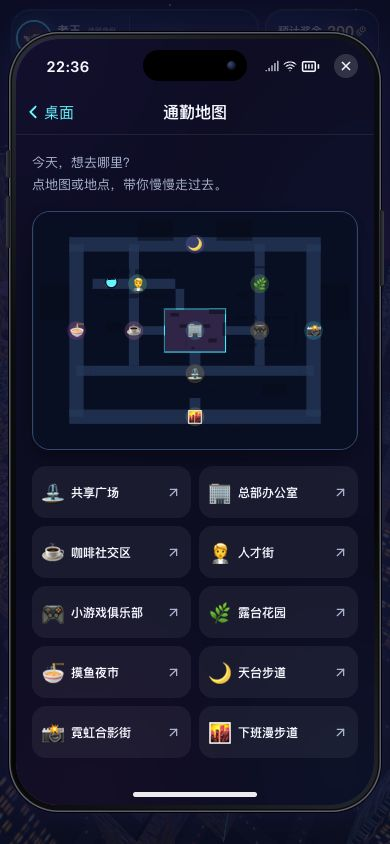
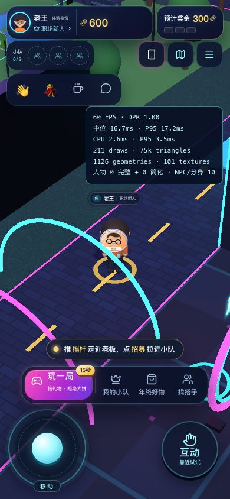

# 90×66 米霓虹街区扩建验收

2026-10-20（本机时区）。Claude Opus 5.5 负责街景、城市天际线与镜头实现；Codex 负责空间规则、NPC、寻路、服务端与网页验收。同一 main 分支协作，未新增运行时依赖。

## 空间与玩法

- 从60×44米扩大为90×66米（x±45、z±33），面积2.25倍。保留原中央广场、总部、电梯、咖啡区、人才街、小游戏和花园的位置，出生张总仍可立即招募。
- 增加外围环街、核心区捷径与四处地点：西侧摸鱼夜市、北侧天台步道、东侧霓虹合影街、南侧下班漫步道。手机通勤地图同步增加四个步行导航入口。
- 四栋店面、长椅与碰撞使用共享空间数据；新灯柱、门架、光拱脚、广告牌和合影装置脚垫补足碰撞，地面与头顶装饰可自由通过。
- 七位虚构NPC保留，空闲的Tony和小樱会沿不同街道散步，停留14秒后继续，其他NPC保留固定地点。签约后仍随自己的主人行动，离线主人仍使用团队工位。NPC不计入真实在线人数。
- 巡游按服务端校时后的时间计算，路线仅首次缓存构建；不逐帧寻路、不增加SSE位置消息。手机“去找TA”和点击巡游NPC会刷新目的地，靠近后保持跟随，手动操作或打开面板终止导航。
- 入场城市→总部→电梯→落地演出保留；招募/挖角近景沿用原逻辑。俯瞰镜头另按屏幕比例适配，随行近景距离不变。

新店面、天台、光环当前是可探索街景与合影布景；没有增加新的购买、拍照导出或奖励规则。扩大地图本身不增加全服人数或完整人物模型的预算，沿用26/30米距离同步、桌面12/手机6个完整远端人物等规则。

## 自动验证

- `npm test`：Go API、计分/传输/距离同步、碰撞、渲染预算、小游戏、音效均通过，原始记录 [tests.txt](../artifacts/campus-expansion/tests.txt)。
- 地图检查：88条出生点到地标/招募点路线；196组新旧地标与环街角点互通；路段每0.05米做独立碰撞检查，池塘/终端等不可站立的起点只检查可达性。
- 核心咖啡/小游戏/人才街仍小于9秒步行。两位NPC按25ms采样十分钟，位置连续、未穿过碰撞体；张总和员工分身不进入脚本巡游。
- 新增 `contracts/world-contract.json`，Go与TypeScript共同校验90×66米边界。API测试实际按正常速度走到x40，超出x45被拒绝。
- `go test -race ./...`、`go vet ./...`、TypeScript检查与独立前端构建通过。
- [CPU微基准](../artifacts/campus-expansion/cpu.json)：100,000次碰撞查询，JS空间索引中位3.422ms，JS线性15.853ms，Rust/WASM线性15.274ms；寻路中位0.320ms、P95 1.925ms。保留现有JS空间索引，WASM继续只是可选对照实验。

## 实际网页验收

使用独立8806测试服务和 `/tmp` 假数据数据库，原8787服务及 `data/boss.db` 保留。默认后期与阴影、自动画质、DPR1，`?perf=1`仅用于读取性能面板。

- 通过手机通勤地图，从核心步行到摸鱼夜市，再跨区到霓虹合影街，真实角色沿寻路移动。
- 从手机人才名册定位散步中的Tony，持续跟至互动范围并实际支付300签约，正常触发入队演出与项目时长+2秒技能；确认后钱包为300、小队1/3。
- 手机390×844：地图10个地点均可操作；左下摇杆和右下情境键保留；摇杆按住800ms后释放，active状态清除；文档宽度390，没有水平溢出。
- 手机844×390：仍保留摇杆和情境操作，文档宽度844，没有水平溢出。
- 本机桌面夜市近景约60 FPS，CPU中位2.4ms、P95 3.5ms；手机视口合影街约60 FPS，CPU中位2.6ms、P95 3.5ms，211次绘制。采样仅代表本机浏览器和相应视口，不代表真实手机硬件，也不是多人容量报告。打开手机时后台约30帧为已有主动限帧策略。
- 浏览器未发现应用错误，仅有现有Three.Clock弃用提示。

## 协作与用量

Claude只完成一轮聚焦的前端场景实现，共修改Campus、City、FollowCamera并新增StreetDistrict。Codex随后补充碰撞、巡游与动态寻路，并修正全景裁切和窄屏取景（竖屏采用广角镜头，全景使用对应雾距，避免拉远后场景被雾遮住）。Claude `/usage` 显示当前五小时窗口总用量39%（包含此前其他会话），低于用户指定50%上限；该会话输入93%来自缓存。完成后关闭本轮Claude终端，未继续消耗其模型额度。

## 画面

