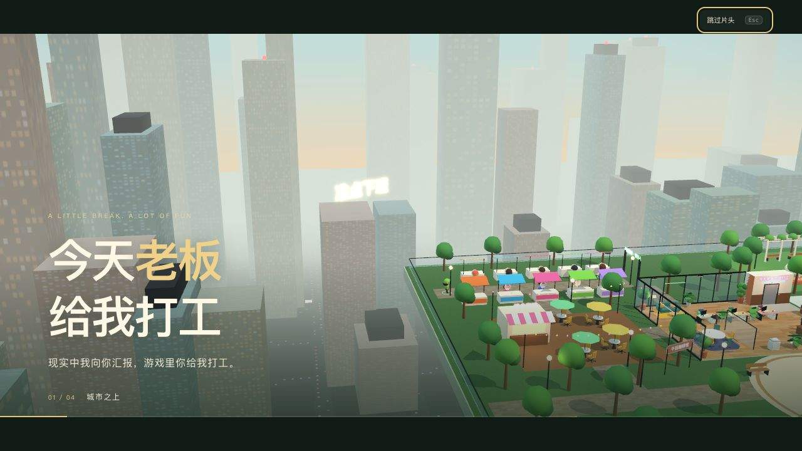
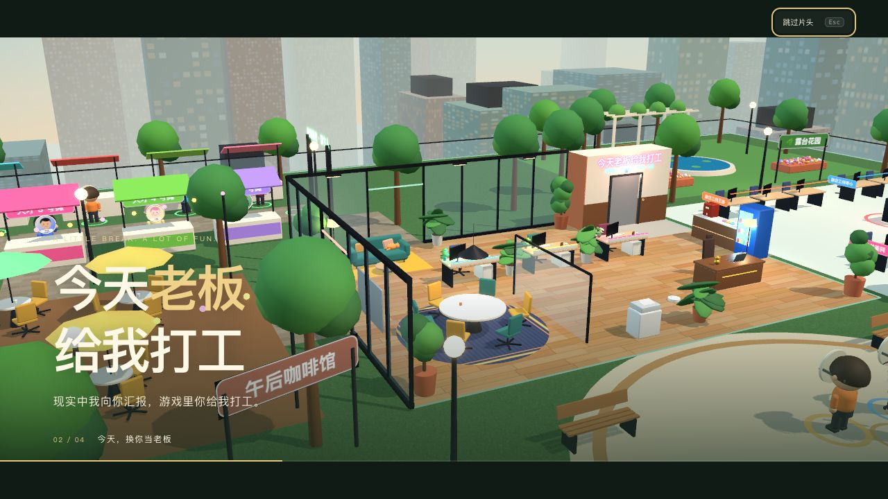
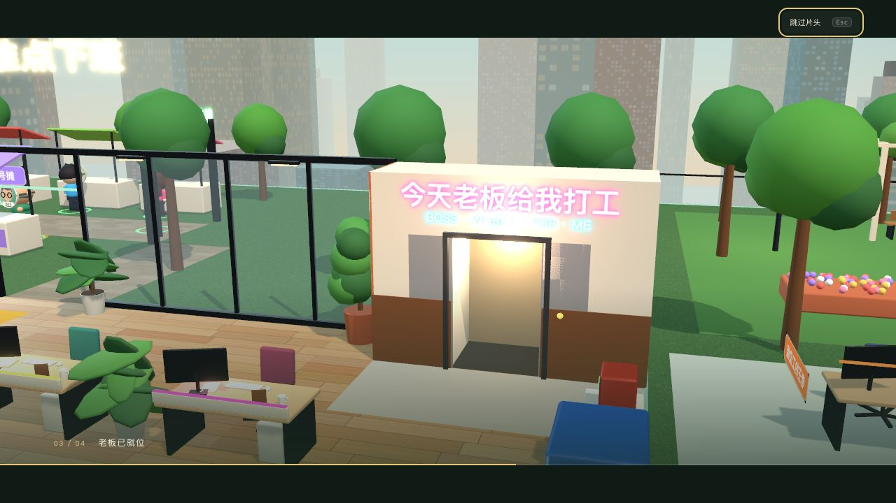
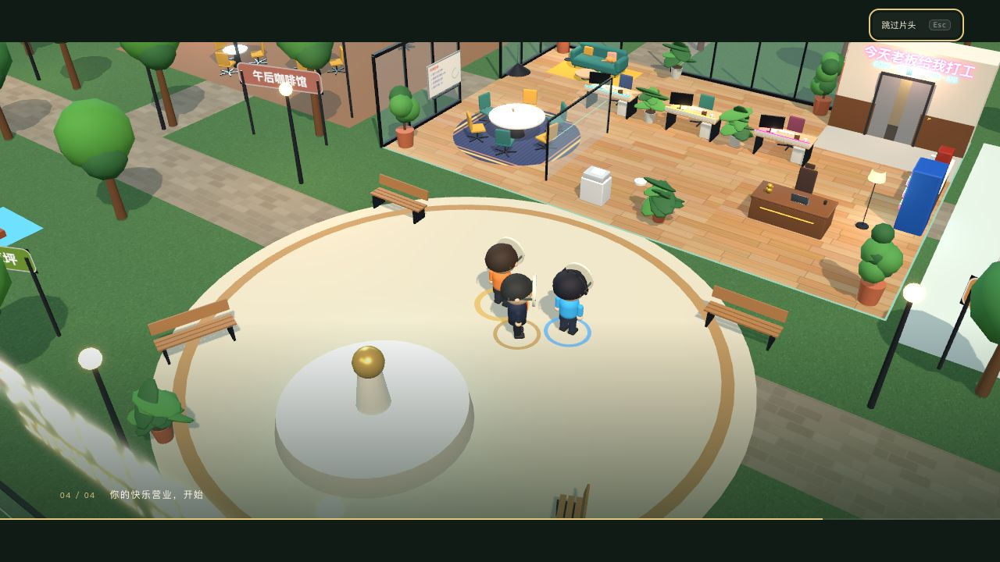
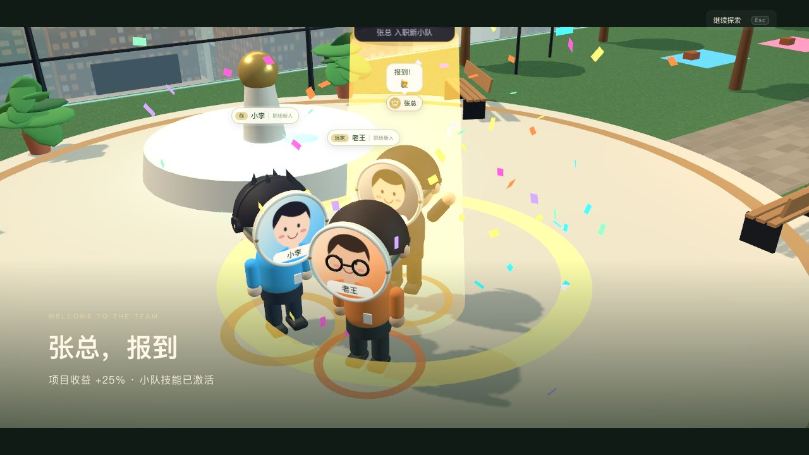

# 电影开场与转场恢复

自由探索版本曾将 Claude 原版9秒片头缩为1.7秒俯冲，同时移除了角色事件聚焦与片头标题。本次从 `ce76605` 的 `CameraRig.tsx`、`Hud.tsx` 和 `Actors.tsx` 对照恢复演出，沿用当前园区、养成、社交和头像面具。

## 当前演出

- 九秒片头：城市远景 → 掠过总部工位 → 霓虹电梯与开门 → 平滑回到当前玩家。标题、电影遮幅、章节进度与3D镜头共用时钟。重连后以实际玩家位置回场。
- 片头期间暂停移动；点击跳过或按 Esc 直接归位。菜单可重播。系统减少动态效果偏好下采用短静态开场。
- 签约和挖角：短转场进入实际人物特写，跟随朝向取正面三分之四角度，保留头像面具、纸箱、行走、彩纸与技能激活动作。到队报到字幕接续当前镜头，不重复全屏转场。
- 事件镜头结束后平滑回到跟随视角；拖动、移动、Esc 或「继续探索」可接管镜头，取消后报到不会再次抢镜。小游戏界面期间继续保留玩家的小游戏视图。
- 电梯镜头恢复粉/青霓虹招牌，移除原本横挡在门洞下半部的木饰板。电梯为片头的环境镜头，角色签约后仍在园区现场加入并跟随小队。

## 实机验证

使用独立8791端口、独立临时SQLite数据库，两张真实网页分别登录老王、小李。

1. 从菜单重播并完整播放9秒片头，四个章节均保存截图；自然结束后HUD与跟随视角恢复。
2. 验证按钮跳过、Esc跳过与菜单重播。片头期间按W，服务端位置保持 `(0,11)`；回场后按D700ms，实际位置变为 `(1.53,9.9)`。
3. 老王300签约张总，小李380挖走，老王480挖回，小李600再次挖走。双方均看到转场和实际角色动作；字幕显示真实转会补偿，完成这轮挖角时两人金币702/52，账本检查无差异、无负数、无重复归属。
4. 检查回场后的菜单、地图和招募交互；修复新增HUD包装层使菜单点击穿透到地面的回归。通过名册再签约钱多多300，列表自动收起；按Esc取消镜头后打开地图，角色报到不会再次抢镜，老王余额402，账本检查仍通过。
5. 浏览器运行错误为0。TypeScript/Vite构建、33项Go测试、36组规则契约与72条路径校验通过。浏览器验收脚本的登录/签约助手同步适配片头与自动回场；本轮未运行完整Playwright CLI套件。

图片来自实际网页，未经重绘：

账本与移动证据见 `artifacts/cinema-restored/verification.json`。本轮截图与输入验证以桌面视口进行；窄屏保留适配，但本轮未额外执行完整手机端演出验收。
