# 卡通赛博园区 · 整体风格验收

本轮将手机之外的整款游戏统一成赛博朋克风格，沿用当前角色、头像面具、地图、寻路、交易和养成规则。

## 画面改动

- 天空、远雾和城市变为蓝紫夜景，恢复星光，增强城市窗灯，部分楼宇增加青/粉轮廓灯。
- 办公室和园区家具采用石墨蓝、金属与玻璃材质；保留低饱和绿植和人物自然肤色。草地、铺装和室内地板的原生程序纹理同步调整。
- 新增步道边缘灯带，广场灯环收细，办公室与平台边缘灯带统一青/粉色。灯带采用自发光几何，没有新增园区动态光源；低特效关闭Bloom后仍然可见。
- 主界面、登录、名牌、聊天、地图、抽屉、确认框、小队、晋升、商店、小游戏和结算全部使用深色面板。主要操作粉紫渐变，导航/焦点为青色，金币/年终奖为金色。
- 试衣间、小队与小游戏角色预览新增实体发光展台和轮廓光，头像面具与已购衣服仍使用实际玩家数据。
- 沿用9秒电影开场和角色事件镜头；字幕、转场擦屏、庆祝纸片同步新配色。

## 改造前后

两张图均为真实网页1280×720桌面视口。前图来自本轮改造前的风格审阅，后图是新版本回到共享广场的画面；人物朝向及站位略有差异。

| 白天版本 | 赛博夜景版本 |
| --- | --- |
| 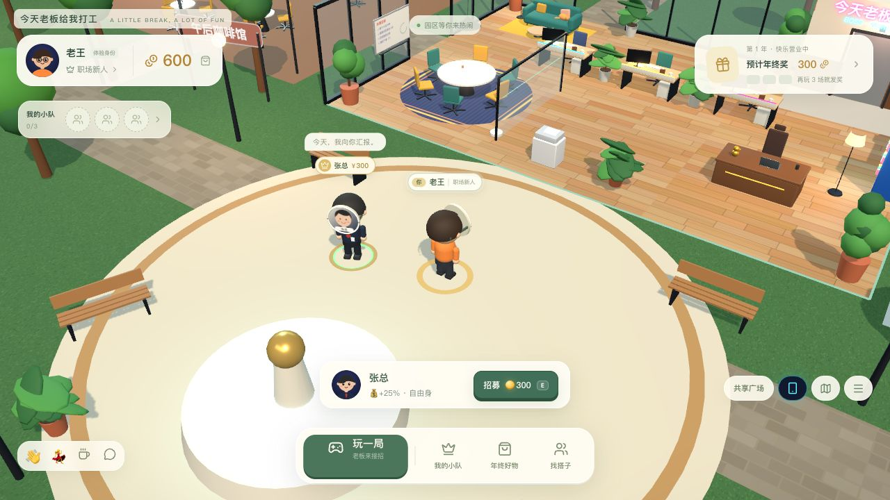 | 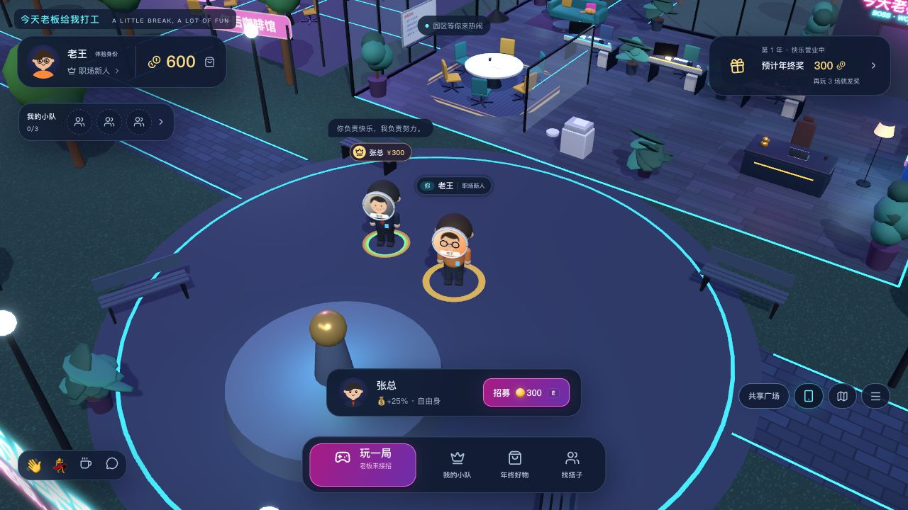 |

## 实机流程

使用独立8791端口和 `/tmp/boss-cyber-campus-20261020.db`，三张真实网页分别登录老王、小李和阿美。未操作普通8787环境的游戏数据。

1. 登录、完整片头、跳过与菜单重播正常；查看城市、办公室与电梯所在章节，回场后HUD恢复。经手机地图从办公室步行回到共享广场，路线可见。
2. 从手机小队花300金币招募张总，出现实际人物的欢迎、报到、彩纸与技能激活动画，头像面具可识别；事件镜头退出后恢复探索。
3. 通过真实网页可见礼物和单按钮完成三局，依次20/22/22命中、510/592/592金币，均显示服务器核对。第一局后晋升项目专员，小游戏加成由老板25%变为老板＋职级30%。
4. 三局后收到444金币年终奖，进入商店实际兑换160金币薄荷假日，余额2,438→2,278。3D预览和园区人物同步穿戴，刷新保留头像、衣服、职级与余额。最终又以640成长、3场有效游玩晋升团队主管，截图展示最终庆祝样式。
5. 小李380金币挖走张总，老王收到342补偿；老王480挖回，小李收到432补偿。双方看到真实离队/入队镜头、纸箱与状态更新。最终金币老王2,140、小李652，张总属于老王、下次报价600。账本审计无差异、无负数、无重复归属、无超员，数据见 `artifacts/cyber-campus/verification.json`。
6. 独立阿美网页以 `?lowfx=1` 检查关闭后期/阴影的画面；道路灯带、人物与界面仍可辨认。390×844窄屏没有横向溢出，底栏位于视口内；商店完整显示六件商品、人物展台和购买按钮，手机可打开、关闭与返回。
7. 三张页面的浏览器运行错误均为0。TypeScript/Vite/Go构建、33项Go测试、36组规则契约和72条地图路径校验通过，差异空白检查通过。本轮进行了上述实际网页输入验收，未运行完整Playwright CLI套件。

本轮没有改动后端协议、经济参数、碰撞体或功能规则。窄屏使用桌面浏览器的视口模拟，尚未测量真实手机硬件帧率；低特效检查确认的是可玩性与画面可辨识度。

## 实机截图

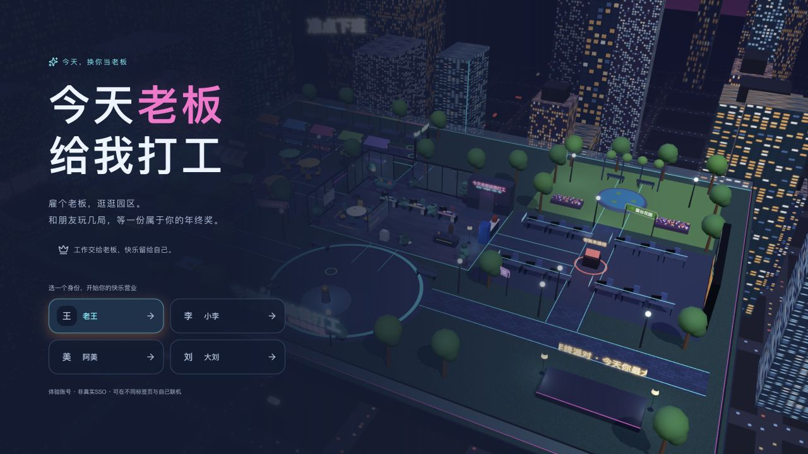
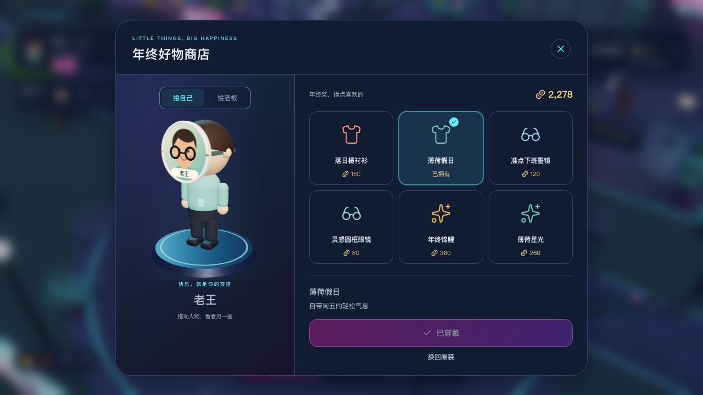
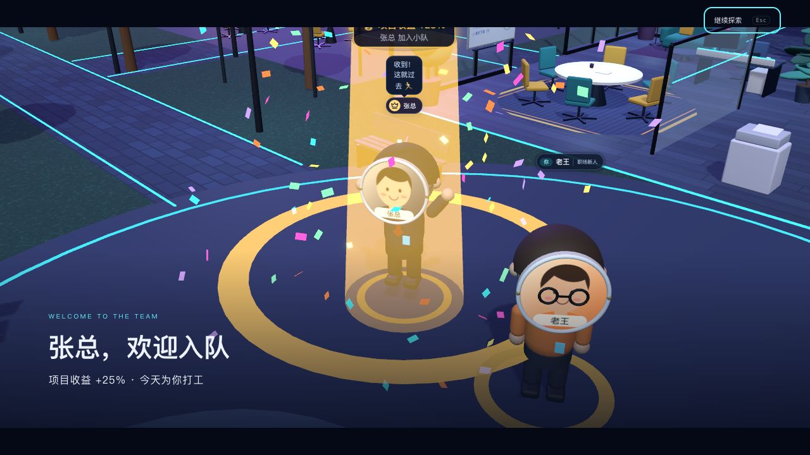
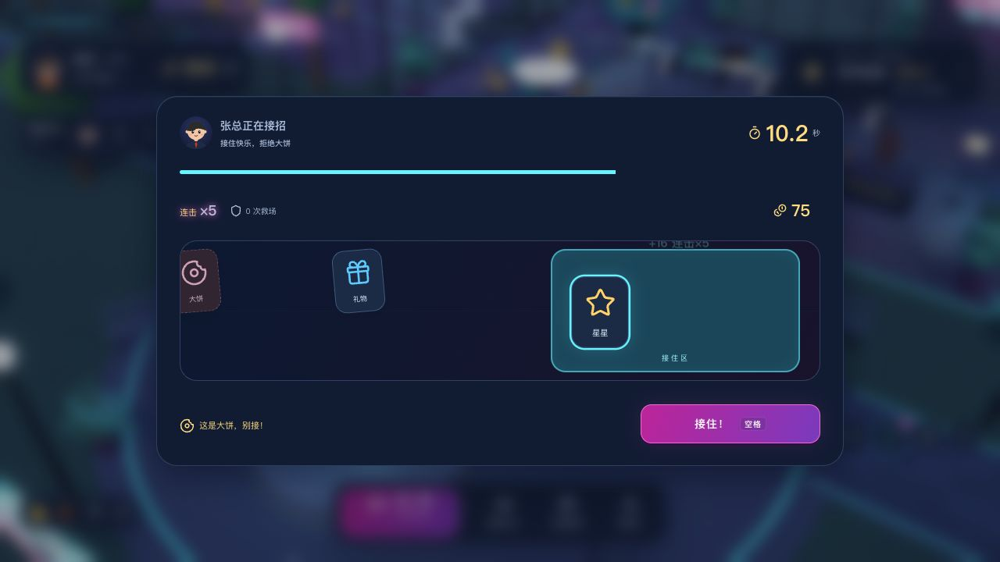
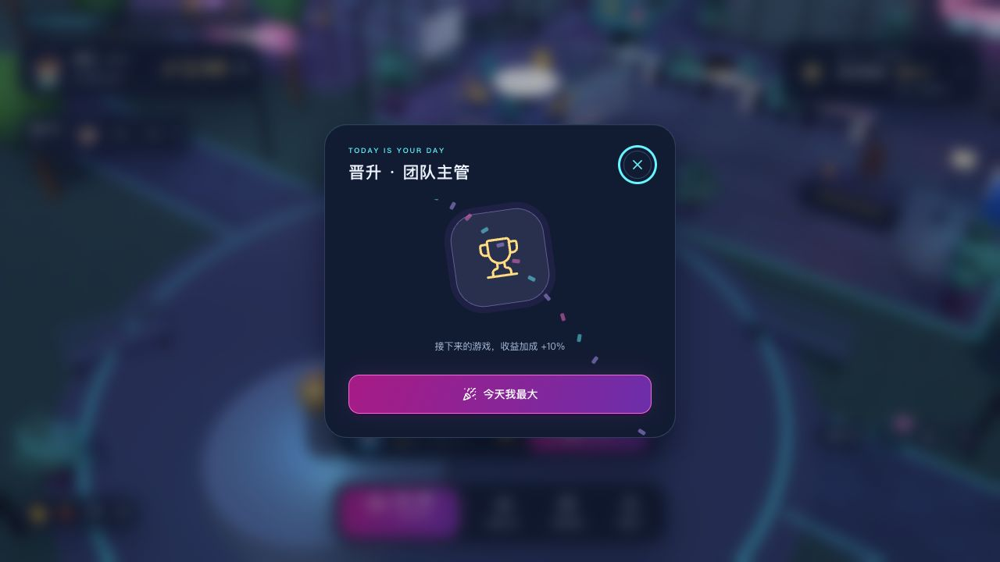
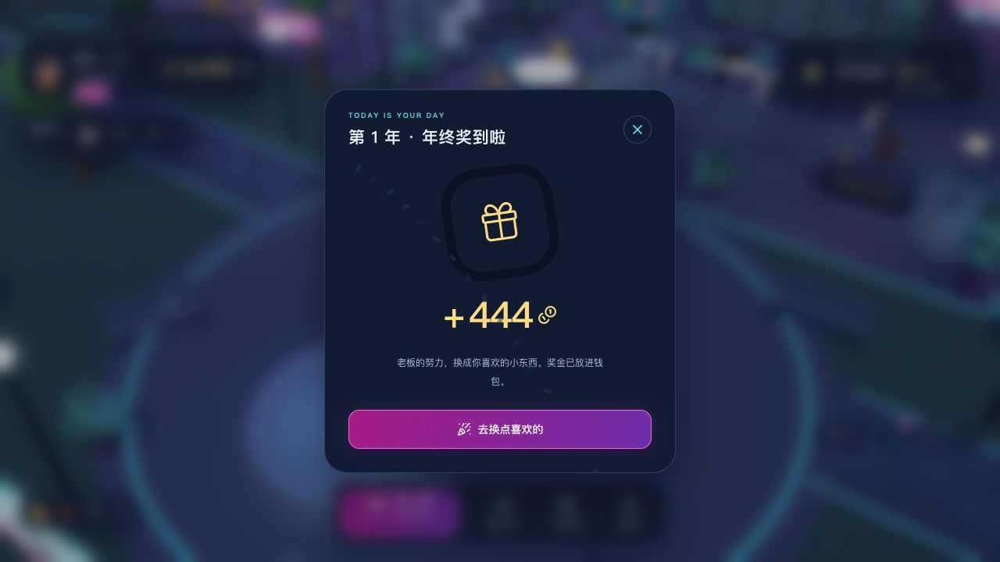
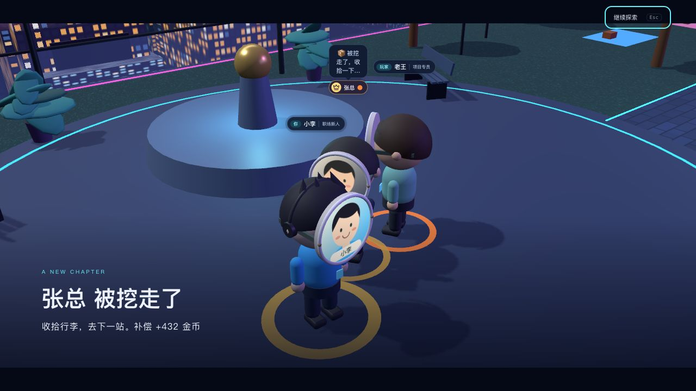
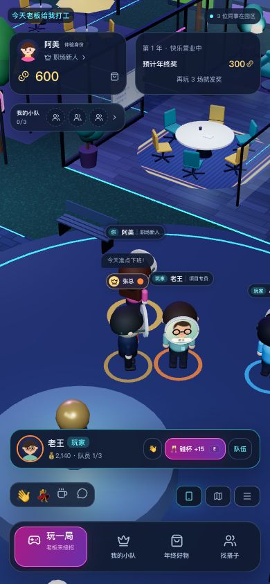
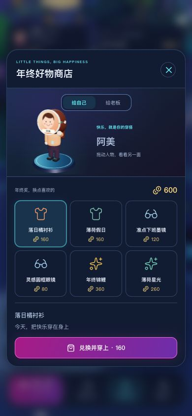
