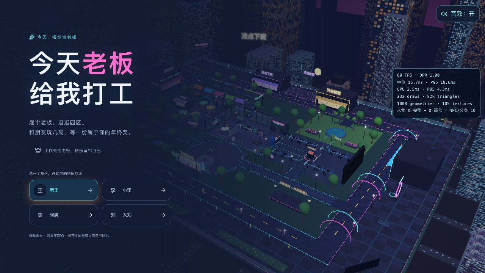
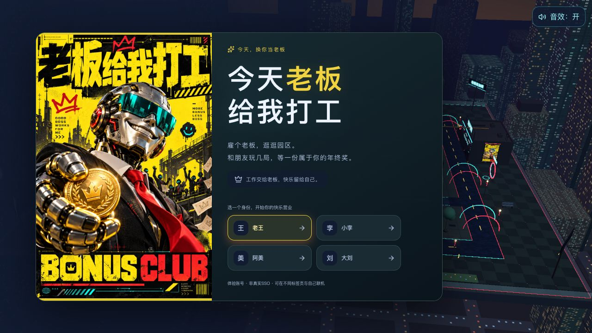
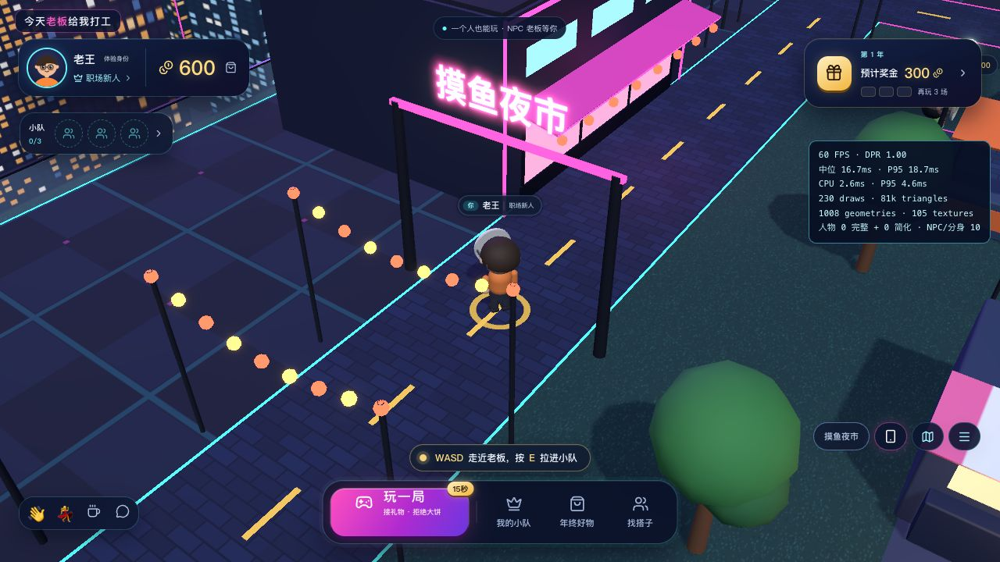
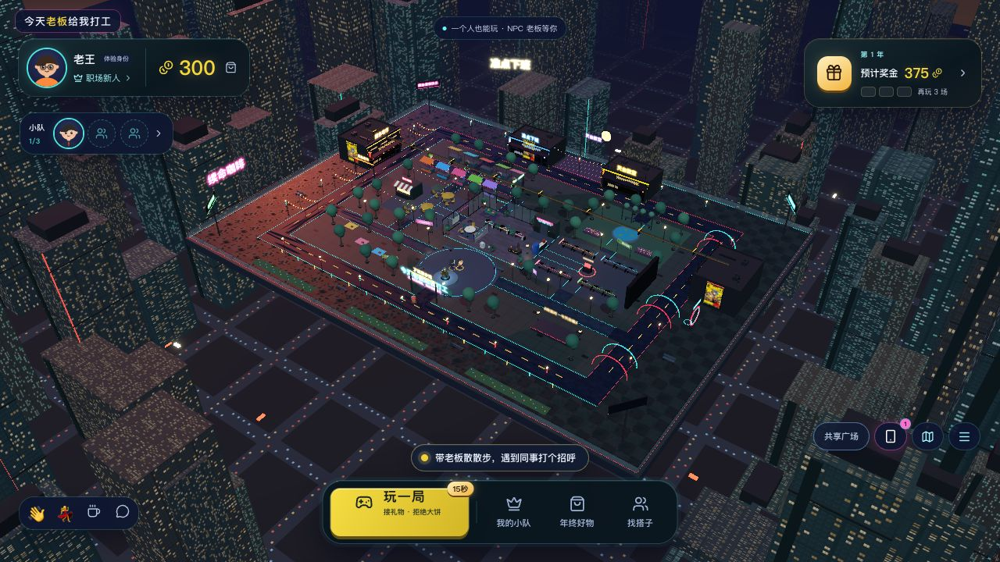
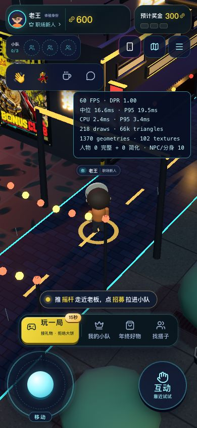
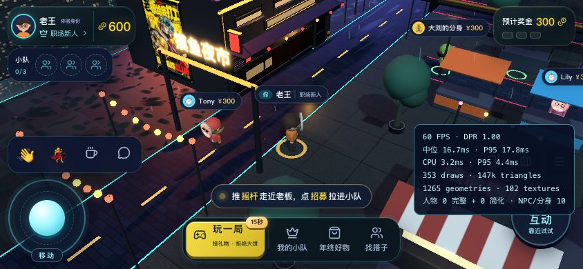

# 夜之城方向的美术精修验收

2026-10-20，本机隔离测试服务 `127.0.0.1:8806`，独立测试数据库。原有8787服务和数据库保持不动。本轮只调整前端美术与登录主视觉。

## 方向与交付

按用户要求，参考 [Cyberpunk 2077 官方夜之城场景](https://cdn-l-cyberpunk.cdprojektred.com/cyberpunk2077/nightcity/Cyberpunk2077_Above_it_all_RGB%401x.jpg) 的工业结构、暗部留白、冷暖照明及黄黑企业广告，保留本游戏的卡通人物、俯视自由漫步与轻松社交。此参考用于美术语言，不代表复刻其写实画面或使用其素材。

- 店铺：厚窗框、暗玻璃、局部室内光、半落百叶、双门、金属硬棚、分层灯箱、空调和管道；四家店铺各有冷暖主题。
- 环境：工业水泥及街砖细节、柔和湿润粗糙度变化、受控泛光、暗青金属与琥珀灯光。远景楼体增加楼层结构线和服务立柱，降低整片亮窗的重复感。
- 主题：原创“老板递奖金”广告进入登录页与街边灯箱，广场增加对应机器人雕像。素材路径与生成提示词见 [素材说明](../public/art/README.md)。
- 表现预算：静态几何继续合批，远楼结构继续实例化；未增加物理点光源预算或运行依赖。雨线为110条、1次绘制、一个时间 uniform；流畅画质、降级层级、全景及系统减少动态效果下隐藏，`lowfx=1`不挂载。

Claude Code（Opus 5.5）仅实现店铺几何与材质；Codex负责参考审查、其余环境、原创主视觉、整合、性能和实际网页验收。Claude五小时窗口总用量从39%到41%，低于用户设定的50%上限，完成后关闭会话。

## 三步截图审查

以下“改前”均为本轮修改前实际截图，“改后”为实际浏览器运行；不是设计稿。

| 步骤 | 改前观察 | 改后与验收 |
| --- | --- | --- |
| 进入游戏 | 身份入口清楚，但焦点主要依赖标题文字 | 原创黄黑海报形成主视觉；完整展示海报、不裁掉标题。手机隐藏装饰海报，保留登录流程 |
| 逛夜市 | 整块发光橱窗、粉色棚、整洁草地，店面结构偏单薄 | 硬棚、门框、百叶、设备和广告形成层次；材质受光更克制。最终复核时进一步柔化湿地纹理，去掉明显椭圆斑点 |
| 看全景、回到操作 | 园区地标可辨，远楼密集重复 | 保留90×66米布局及所有道路碰撞；远景冷暗、街区暖亮，操作焦点用黄色突出。全景、头像面具、招募后跟随仍可辨认 |

### 进入游戏

改前：


改后：


### 夜市近景

改前：


改后：


### 全景与触屏





手机截图采自最后一次湿地纹理柔化前，布局和几何与最终版一致。

## 实际验证

- `npm test`：Go测试及前端契约、传输、邻近玩家、导航、碰撞、渲染预算、小游戏和音效检查通过，记录 [tests.txt](../artifacts/night-city/tests.txt)。最后一次纯材质调整后重新运行 `npm run test:web`，全部通过，记录 [tests-web-final.txt](../artifacts/night-city/tests-web-final.txt)。
- `npm run build:web -- --outDir .run/art-web`：TypeScript和生产构建通过。主JS约1,593 kB，gzip约458 kB；新增原画WebP约326 KiB，三处灯箱共用一张纹理。
- 浏览器：实际进入园区、走手机地图到夜市/广场、键盘移动、切换全景、招募张总及入队转场完成；金币600→300、小队0→1、奖金300→375，跟随正常。开场镜头保留，见 [开场截图](../artifacts/night-city/11-intro.jpg) 与 [入队后](../artifacts/night-city/10-after-recruit.jpg)。本轮未重复完整双玩家挖角流程。
- 390×844：文档宽390，无横向溢出；按住摇杆800 ms后松开，摇杆回到非激活状态。844×390：文档宽844、高390，操作区保留。手机登录表单正常，见 [截图](../artifacts/night-city/06-mobile-login.jpg)。
- `lowfx=1`：场景、原创广告、人物、头像和交互可见，雨线及后期关闭，见 [截图](../artifacts/night-city/13-lowfx.jpg)。控制台未捕获error，见 [日志](../artifacts/night-city/browser-errors.json)。已有Three.Clock弃用提示不属于运行错误。

| 本机IAB浏览器采样 | 帧率 | CPU中位 / P95 | 绘制 / 三角形 |
| --- | --- | --- | --- |
| 1280×720 夜市 | 60 FPS | 2.7 / 3.8 ms | 264 / 87k |
| 390×844 夜市 | 60 FPS | 2.4 / 3.4 ms | 218 / 66k |
| 1280×720 lowfx夜市 | 60 FPS | 2.5 / 3.8 ms | 220 / 55k |

原始采样：[桌面](../artifacts/night-city/performance-desktop.json)、[窄屏](../artifacts/night-city/performance-mobile.json)、[lowfx](../artifacts/night-city/performance-lowfx.json)。这些是本机浏览器视口测试，不是实体手机或多人压力测试，也不是所有设备的60 FPS保证。截图中调试面板仅由`?perf=1`启用。

可见风险与边界：招牌仍保留夸张霓虹效果，截图不能证明所有场景对比度、读屏或完整WCAG合规；本轮检查了触屏尺寸与溢出，未执行系统减少动态效果的浏览器模拟。湿润表面使用标准材质和粗糙度贴图，不是光线追踪或屏幕空间反射。

## 本地验收

```sh
git pull
make up
```

浏览器打开启动日志打印的本机或局域网地址；进入游戏后，从手机“通勤地图”走到“摸鱼夜市”，再切换园区全景。旧标签页请刷新加载新构建。
