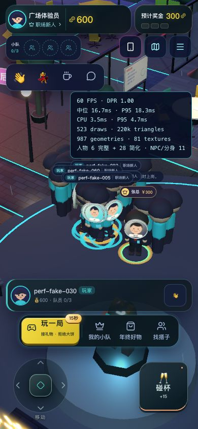

# 前后端性能 Review V3

2026-10-21。本轮使用本机假数据，未连接32核目标服务器，未重启原有8787服务或修改其数据库。保留美术、NPC、地图、玩法和身份SPI。

## 已修复的问题

| 问题 | 处理 |
| --- | --- |
| 快照也使用立即写事务，鉴权/读/写挤在唯一连接上 | 一个写连接保证交易原子性，文件数据库另开2—16个只读WAL连接，快照使用延迟事务。鉴权不缓存，撤销仍查数据库 |
| 全局世界锁内为所有人排序、编码，阻塞移动 | 锁内获取一致输入，锁外并行计算、编码，短暂加锁发布；随人数和可用CPU扩大，最多32个worker |
| 每人全量收集/排序附近人群，反复计算距离 | 最多64候选的堆，距离只评分一次，保留26/30米迟滞、焦点、稳定顺序和慢订阅者恢复 |
| 签约、开局、奖金预览全表扫描；签约为余额还构造整份快照 | 按owner_id索引只查询自己最多3名队员；交易响应单独读真实余额 |
| 一份位置包最多通知Zustand订阅者5次 | 预测目标就绪后，只提交一次完整状态通知 |
| 人群每帧解析颜色、上传相同颜色/静止矩阵 | 外观变化才上传颜色，静止姿态复用矩阵，移动动画保留 |
| 密集经济事件重复拉取状态 | 50ms窗口合并刷新，每个事件仍逐个处理，退出取消旧队列 |
| 构建显示gzip大小，但单进程实际传原始JS | 构建生成JS/CSS的.gz，Go/Nginx协商发送；经济快照使用池化快速gzip；SSE不压缩、不缓冲 |

碰杯在触发时校验距离，释放世界锁做交易，提交后重新读取当前位置设置表情，避免覆盖等待期间的移动。没有新增WASM依赖；本轮确认的瓶颈在数据库排队、锁、编码及重复工作。

## 后端基准

Apple M4、10逻辑核、16 GiB，Go1.27.2；前后均限制`-cpu=8 -benchtime=300ms -count=2`，以下为两次均值。使用磁盘WAL数据库，广播包含视野计算、编码和邮箱发布。

| 项目 | 改前 | 改后 | 比率 |
| --- | ---: | ---: | ---: |
| 100人分散，广播一轮 | 3.934 ms | 1.270 ms | 3.10倍 |
| 100人密集，广播一轮 | 3.732 ms | 1.505 ms | 2.48倍 |
| 300人分散，广播一轮 | 20.861 ms | 3.492 ms | 5.97倍 |
| 300人密集，广播一轮 | 11.604 ms | 3.459 ms | 3.35倍 |
| 100人目录，并发快照摊销时间/次 | 0.706 ms | 0.160 ms | 吞吐4.41倍 |
| 1000人目录，并发快照摊销时间/次 | 5.292 ms | 1.265 ms | 吞吐4.18倍 |

新增1000人广播：分散14.265 ms/轮，密集12.538 ms/轮；无改前样本，不做加速比。300人广播分配量：分散25.8→14.5 MB/轮，密集32.9→14.9 MB/轮。1000人目录快照约5.77→3.77 MB/次。

RunParallel的ns/op是并发吞吐摊销成本，**不是单个HTTP延迟**。结果不是目标32核容量或1000台真实浏览器保证。1000人广播仍分配约50 MB/轮，长期GC尾延迟需在目标机测量。

原始记录：[改前](../artifacts/performance-v3/backend-before.txt)、[改后](../artifacts/performance-v3/backend-after.txt)、[汇总](../artifacts/performance-v3/comparison.json)。

## 传输

主JS约1.594 MB，预压缩约457 KB，传输减少约71%，静态压缩在构建时完成。1000假玩家状态样本735,029字节→gzip 26,386字节；样本有大量重复配置，真实资料的压缩率会不同。

状态仍no-store，解压后内容不变。拒绝gzip时回退。静态Range、HEAD、MIME、缓存与根目录隔离保留。/api/events不经过压缩器，Nginx压缩类型也不含text/event-stream。见 [压缩与读写并发验证](../artifacts/performance-v3/compression-and-concurrency.txt)。

## 前端浏览器

100个真实HTTP/SSE假客户端持续移动，加一个浏览器操作者，共在线101。同一账号、地点、自动画质、DPR1：

| 视口 | 改前FPS / CPU中位 / P95 | 改后FPS / CPU中位 / P95 | 人群预算 |
| --- | --- | --- | --- |
| 1280×720 | 60 / 3.8 / 4.7 ms | 60 / 3.9 / 4.8 ms | 12完整+48简化 |
| 390×844 | 60 / 2.9 / 4.0 ms | 60 / 3.5 / 4.7 ms | 6完整+28简化 |

**本次采样没有证明前端CPU时间降低。** 运动相位、角色选择和运行时状态有波动，两个视口均维持60 FPS，CPU仍在单帧预算内。已验证收益是减少重复工作、事件风暴及首包传输，不推导未测出的FPS提升。视口测试不是实体手机测试，GPU、发热和长期帧尾需真机验证；32核服务端不会改善手机GPU瓶颈。

实际碰杯：钱包600→615、奖金300→330，消息和表情正常；100假客户端持续移动记录到0个请求失败。本轮未重录完整晋升/挖角。控制台无error，见 [日志](../artifacts/performance-v3/browser-errors.json)。原始采样在artifacts/performance-v3/frontend-{before,after}-{desktop,mobile}.json。




## 检查

- 生产前端构建、TypeScript、npm run test:web通过。新增100事件合并、刷新中再次到达事件、退出取消、失败不消费旧事件测试。
- go test -race ./...、go vet ./...通过，涵盖交易原子性、身份隔离、100客户端HTTP/SSE与视野收敛。
- WAL测试：未提交钱包写事务期间，鉴权/快照返回已提交余额；提交后见新余额，只读池拒绝写入。
- 视野测试：100种随机场景，每种500人，与全排序参考逐项一致；既有迟滞/焦点/离开/慢消费者/旧客户端测试通过。
- 压缩测试：千人JSON解压逐字节一致，拒绝gzip、静态Range/HEAD、压缩文件符号链接越界测试通过。最终Go二进制HTTP冒烟验证了JS实际传输1,594,147→456,683字节，状态可正常解压，SSE保持未压缩，见 [结果](../artifacts/performance-v3/http-smoke.json)。Nginx模板未进行容器实跑验证。
- 后端源码包已解压到独立临时目录，仅使用Go运行全部测试通过，见 [源码包验证](../artifacts/performance-v3/package-tests.txt)。

日志：[前端](../artifacts/performance-v3/frontend-tests.txt)、[Go竞态](../artifacts/performance-v3/go-race-tests.txt)、[最终压缩竞态检查](../artifacts/performance-v3/compression-final-race.txt)、[vet](../artifacts/performance-v3/go-vet.txt)。

## 32核部署

每个世界保持一个Go进程。worker最多32，只读连接最多16，写事务仍单连接。GET /api/health显示parallelism和dbReaders，核对容器实际CPU配额。不要为32核启动32个独立世界实例，当前位置/SSE总线仍在进程内。

Go按CPU/容器配额设置并发度，无需代码写死32；核对遗留GOMAXPROCS限制。[Go官方说明](https://go.dev/blog/container-aware-gomaxprocs)。数据库放本机SSD/持久卷，WAL支持并行读但只有一个写者，更多CPU不会增加并行提交能力。[SQLite官方说明](https://sqlite.org/wal.html#concurrency)。

目标机复测：

```sh
make perf-api BENCH_CPU=32
make test-crowd
```

独立后端源码包无需Node，也可直接运行：

```sh
go test ./backend -run '^$' -bench 'Benchmark(CrowdedWorldFlush|SnapshotDirectory)' -benchmem -benchtime=300ms -count=3 -cpu=32
go test ./backend -run TestCrowd100Burst -count=1 -v
```

本轮没有目标机访问，未给出该机器QPS或人数承诺。经济快照仍返回完整玩家/人才目录，全服经济事件仍使客户端刷新状态。若目标是数千人高频交易，需继续拆分目录分页/版本增量，并设计写入存储与多实例消息总线。SSO SPI负责身份，不会自动把SQLite替换为MySQL。

## 重现本机百人网页场景

QA入口强制测试环境及127.0.0.1，只接受假凭证，不是公司SSO或部署入口。使用独立数据库：

```sh
npm run build:web -- --outDir .run/perf-web
APP_ENV=test HOST=127.0.0.1 PORT=8806 DB_PATH=/tmp/boss-perf-qa.db STATIC_DIR=.run/perf-web LOGIN_CALLBACK_URL='http://127.0.0.1:8806/?boss_auth=callback' go run ./artifacts/performance-v3/qa
# 另一个终端
node artifacts/performance-v3/crowd-clients.ts
```

打开http://127.0.0.1:8806/，点击本地假登录入口；登录后加?perf=1查看统计。结束时在两个终端各按Ctrl+C。不得将QA适配器用于真实身份环境。
