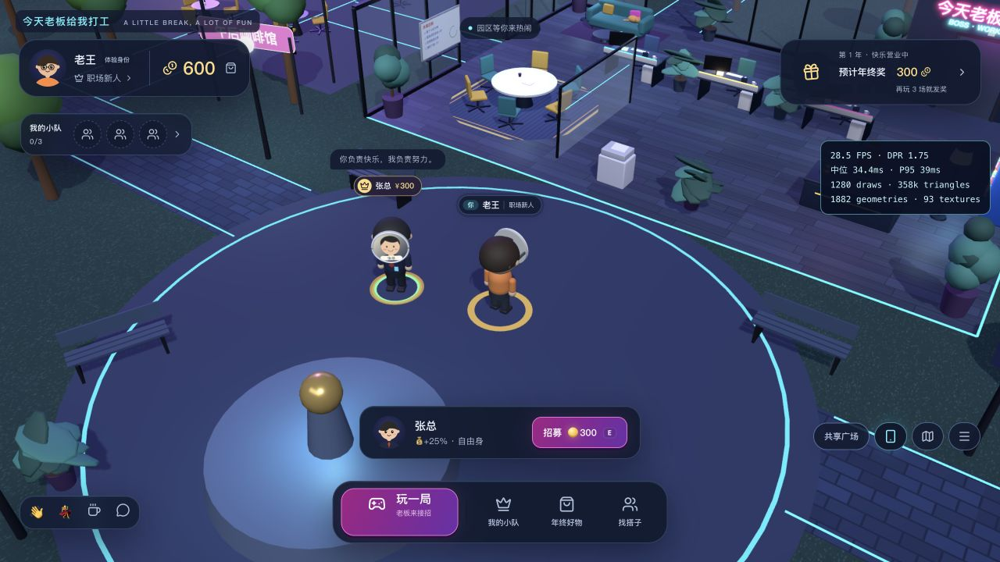
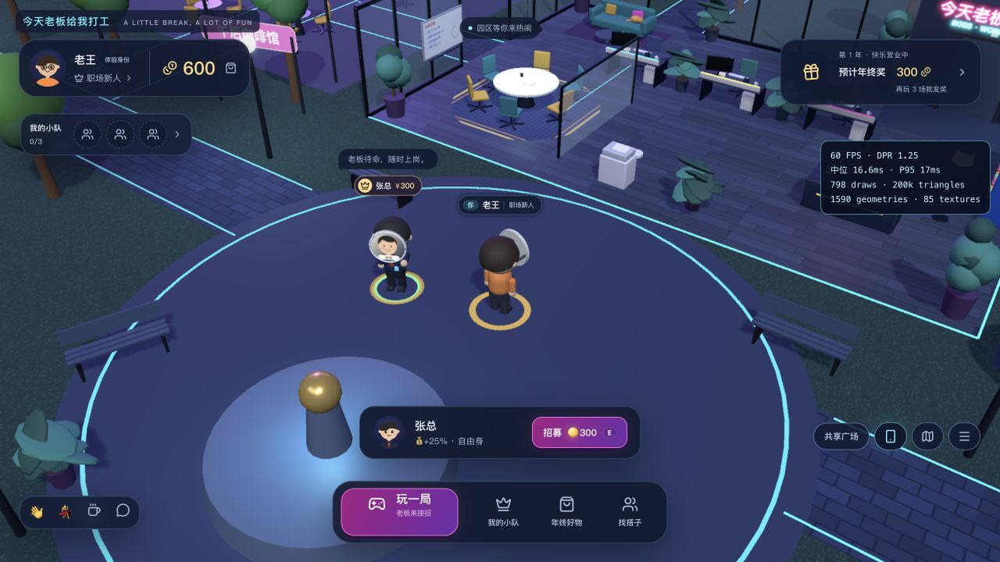
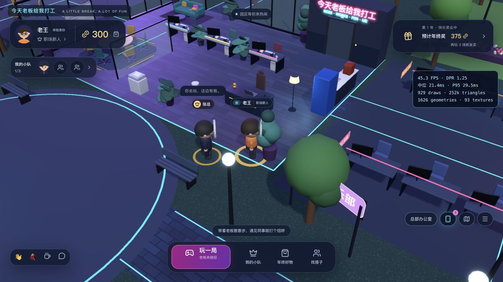
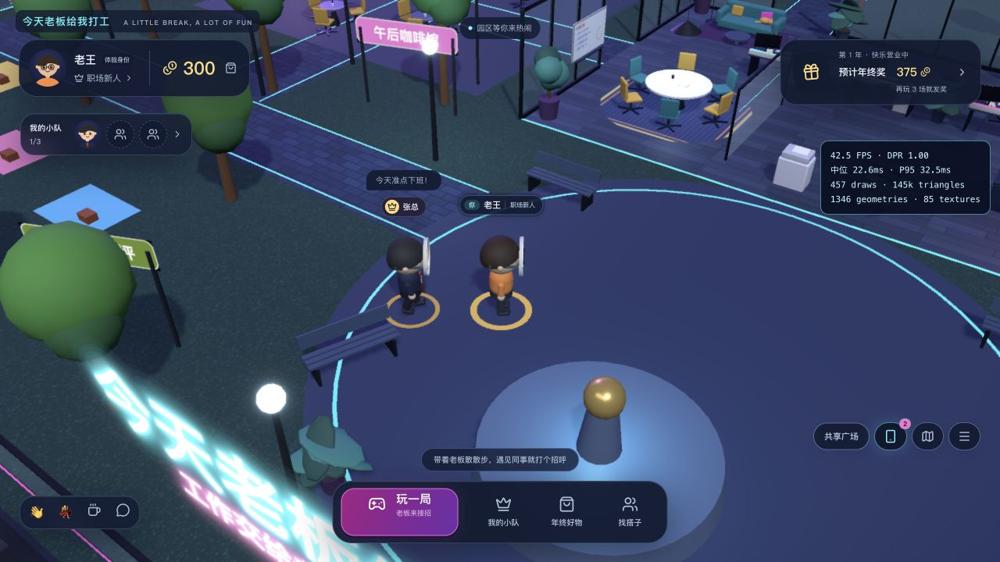

# 前端性能优化验收 · 2026-10-20

目标：保留赛博园区、头像面具和电影镜头，降低自由探索与弹窗中的渲染成本。

## 实测

Apple M4、macOS、应用内 Chromium 浏览器，1280×720 CSS 视口，生产构建、本机 Go 服务、独立测试数据库。数据来自应用内 `?perf=1` 探针；预热后统计最近5秒的真实帧间隔，绘制次数包含主场景、阴影和后期通道。采样时只保留一个本轮测试窗口。

| 场景 | 优化前默认画质 | 优化后初始均衡预算 |
| --- | ---: | ---: |
| 广场静止 FPS | 28.5 | 60.0 |
| 广场静止 P95 帧时间 | 39.0 ms | 17.0 ms |
| 广场静止每帧绘制 | 1,280 | 798 |
| 连续按 D 走动 FPS | 30.6 | 60.0 |
| 连续按 D 走动 P95 | 34.5 ms | 17.2 ms |
| 连续按 D 走动每帧绘制 | 1,339 | 848 |
| 渲染分辨率 DPR | 1.75 | 1.25 |

上述是本轮第一组同位置、同操作样本；后续固定预算版本在招募老板后再次带队走进办公室，测得 **44.7 FPS、P95 29.5 ms**，回到静止状态可达60 FPS。固定预算长时间复测也曾降到 **27.7 FPS**，所以最终版本增加了自动预算控制，持续低帧时逐级减轻负载。上述数字不是所有地图位置、设备或多窗口同时运行都保证60帧的承诺。默认分辨率和阴影预算也有调整，不能将全部提升归因于合批。原始 JSON 和截图位于 [`artifacts/performance`](../artifacts/performance/)。

最终版本增加静态家具合并后，办公室移动样本在DPR 1.25时为 **33.3 FPS / 776次绘制**；自动预算随后降到DPR 1.0，广场移动样本为 **43.9 FPS / 577次绘制 / P95 31.7 ms**。两者位置不同，不能当作严格的相同机位对比，但已在真实运行中确认了自动降档及场景合批生效。另有DPR 0.85时约34.8 FPS的办公室样本。复杂场景仍有帧率波动，继续保留「清晰」「流畅」手动档位。

同时运行两个3D测试窗口时，本机采样约34–38 FPS；该数据受双窗口争用资源影响，没有混入单窗口对照。试衣间打开时，最终版本的背后园区约30.3 FPS，属于主动降低背景刷新频率；试衣间人物使用独立 Canvas。

## 改动

- **减少 React 重渲染**：同事队列只订阅在线身份集合；玩家模型只订阅聊天、表情和各自的过期时间。5 Hz 坐标广播继续进入原来的插值运行时，不再带动整批模型重渲染。加入/离开、聊天和表情变化仍触发更新。
- **城市实例合批**：190栋楼按6种墙体材质批量绘制，屋顶、霓虹竖线、楼顶信标也使用实例。建筑位置、尺寸、纹理与信标形状保持原样。车流颜色只上传一次。
- **静态家具合并**：每盆盆栽的9片叶子按两种材质合成最多2次绘制，高盆栽的6簇叶子也按材质合并；椅子的5根金属脚合成1次绘制。保留原始顶点、材质、朝向和阴影标记。
- **局部灯光池**：原有灯位及灯具发光材质保留，按镜头落点选择最多6盏实际点光源，约每150 ms重新选择。保留电梯和台灯原有动画引用，选中灯的颜色、位置、亮度逐帧同步；主光与环境光保持独立。远处灯具仍发光，但局部照明可能简化。
- **自动预算**：预热12秒后，每2秒统计一次帧时间中位数；连续两窗高于26 ms降低一档，连续六窗低于19 ms恢复一档。跳过隐藏页面、片头/签约镜头和主动限帧的弹窗背景，避免误判与频繁切档。
- **阴影预算**：自动模式初始用1024²贴图，阴影最多约20 Hz更新；不再每个显示帧重画整片园区阴影。切画质会重建对应尺寸的阴影资源。
- **弹窗背景**：手机、抽屉与小游戏覆盖场景时，园区改为按需渲染，定时请求约30 Hz刷新；关闭恢复持续渲染。角色旅行、实时消息与小游戏时钟继续运行。
- **试衣间**：降低像素预算，接触阴影只生成一次；人物动画和旋转继续运行。

## 画质与诊断

右下角「更多菜单 → 画质」循环切换，保存在浏览器本地：

| 模式 | 最大 DPR | 后期 MSAA | 阴影贴图 | 阴影刷新上限 |
| --- | ---: | ---: | ---: | ---: |
| 自动（默认，三级预算） | 1.25 → 1 → 0.85 | 2 | 1024² → 768² → 512² | 20 → 15 → 10 Hz |
| 清晰 | 1.75 | 4 | 2048² | 30 Hz |
| 流畅 | 1.00 | 0 | 512² | 12 Hz |

三档均保留泛光、暗角、人物与演出。`?lowfx=1` 仍可关闭后期与阴影；`?perf=1` 显示最近5秒的 FPS、中位/P95帧时间、整帧绘制次数、三角形数和资源数。未加性能参数时不运行探针。启动、切画质、切场景和首次打开新预览时可能包含资源编译峰值，比较前应等待至少5秒；不要把主动限帧的弹窗背景数据当作自由探索帧率。

## 验证

- `npm run build:web`：TypeScript 与生产构建通过。
- `npm test`：Go 测试、36组规则契约、72条地图路线，以及新增8项渲染回归检查通过。
- 新增检查覆盖：100次移动更新不改变社交选择器结果；聊天、表情、续期和断线仍使结果变化；灯光数量有上限，排名变化保持槽位，移除光源不留下残光；单次慢帧不降档，持续低帧逐级调整，恢复有滞后且档位不越界；静态部件合并保留三角形数量、旋转/非均匀缩放后的包围盒与单位法线。
- 浏览器实测：进入/自动结束片头；连续走动；画质循环切换及持续低帧时DPR 1.25→1→0.85自动调整；手机与试衣间打开/关闭；`lowfx=1`下进入、跳过片头与走动；双玩家在线、聊天、挥手和移动；招募张总后金币600→300、队伍0→1、预计年终奖300→375；实际15秒小游戏完成并显示「结算已核对」（本轮0命中、0奖励）。
- 浏览器无运行时错误；现有 Three.Clock 弃用提示仍来自渲染依赖。
- 本轮使用独立临时数据库，没有重置原有8787服务和玩家数据。未执行整套 Playwright 自动端到端套件；交互验收使用真实浏览器完成。
