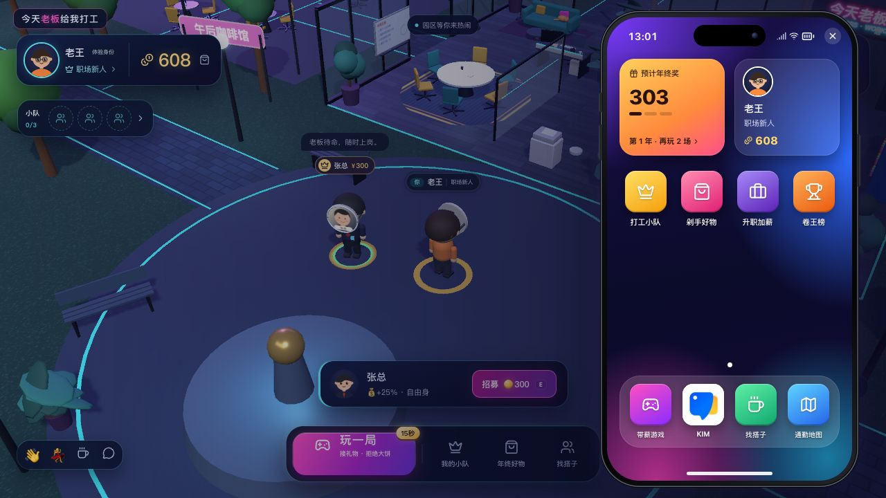
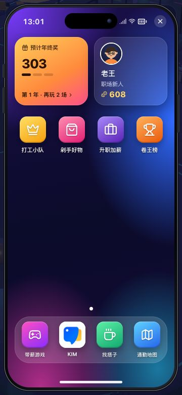
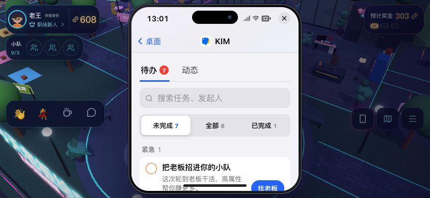
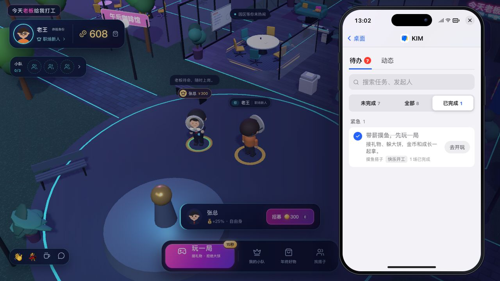

# 游戏手机与 KIM 待办验收

2026-10-20。通过 Orca 恢复同一本机 Claude Code 会话，实测模型为 `claude-opus-5-5`。Claude 负责 `GamePhone.tsx` 和 `phone.css` 的视觉设计与实现；Codex 负责任务数据、代码 review、接入及浏览器验收。五小时总用量从26%到31%，低于用户要求的50%上限；本轮 worker 已完成并关闭。

## 交付

- iPhone 风格黑色机身、灵动岛、系统状态栏、紫蓝渐变壁纸、应用网格和半透明 Dock；没有引入持续动画、新依赖或额外3D负载。
- 八个应用各出现一次：打工小队、剁手好物、升职加薪、卷王榜、带薪游戏、KIM、找搭子、通勤地图。使用有色图标和简短名称。
- KIM 使用官方应用图标，默认进入待办。八条游戏目标包含玩一局、招老板、本年场次、晋升门槛、三人小队、碰杯、年终奖和兑换好物；支持搜索与未完成/全部/已完成筛选。
- 完成状态由服务端快照推导，点击任务进入现有功能；没有本地点一下就完成或额外发奖的接口。晋升门槛任务完成仅表示条件达标，实际晋升仍需进入成长页确认。
- 动态页保留原有通知、与我有关筛选和全部已读。没有接入真实 KIM 账号或任务，素材来源见 [ASSETS.md](ASSETS.md)。
- 保留焦点循环、Escape、应用返回、移动锁、声音及场景后台限帧；关闭键、返回键和底部手势条提供至少44px触控区域。review 修正了奖金预估标记、KIM 蓝色主色、不可访问的第二页指示和小触控区域。

## 验收证据

生产构建，独立8798端口及临时数据库。原8787服务和玩家数据保留。

| 检查 | 结果 |
| --- | --- |
| 390×844、360×780 | 桌面八个入口完整；360px机身边界为 x8/y8、344×764，无横向溢出 |
| 844×390 | 机身340×374位于屏幕内；内部滚动，列表末尾「逛好物」可操作 |
| 1280×720 | 机身不旋转，网格/Dock完整；8个应用均实际打开，外部商店、小队、成长关闭后回手机 |
| KIM搜索/筛选 | 搜索「老板」仅显示对应任务；已完成为空时显示空状态；全部显示8条 |
| 真实游戏循环 | 从KIM开玩，接住1次；服务端核对获得8金币、10成长，本年1/3场；KIM自动变7条未完成、1条已完成 |
| 消息 | 两条个人未读动态，全部已读后未读角标消失 |
| 键盘 | Tab进入关闭键，Shift+Tab循环到手势条；搜索及原有Escape逻辑保留 |
| 性能恢复 | 覆盖期间30.3 FPS，收起后60 FPS；阴影计数2172→2335、灯光选择866→924，继续更新 |
| 自动检查 | TypeScript、生产构建、Go测试、规则契约、地图、碰撞、渲染、小游戏与音效检查通过；diff无空白错误 |

[浏览器记录](../artifacts/phone-ios/browser-checks.json)。现有 E2E 脚本的导航断言同步为网格4项+Dock4项，本轮通过应用内浏览器验收，未另跑整套 Playwright 脚本。视口模拟不代表实体 iPhone 的触摸、软键盘和硬件性能测试。

