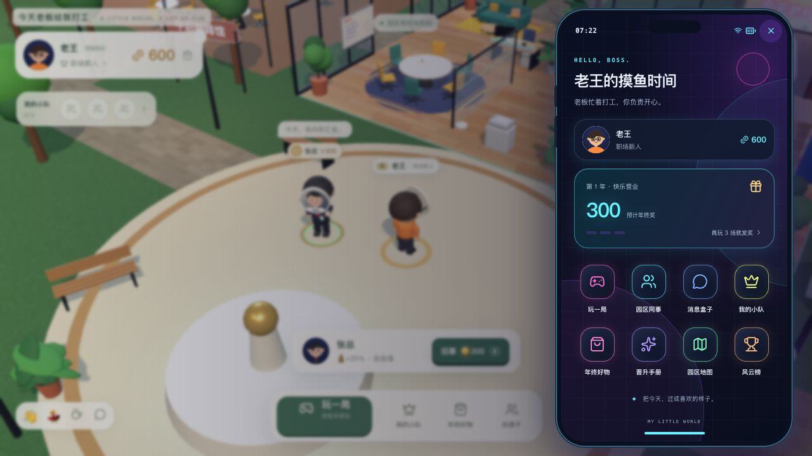
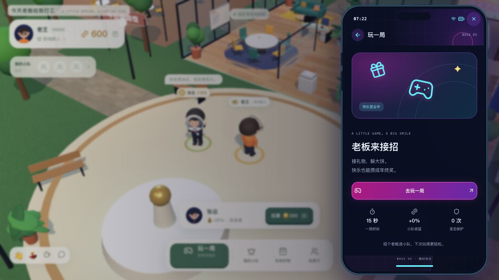
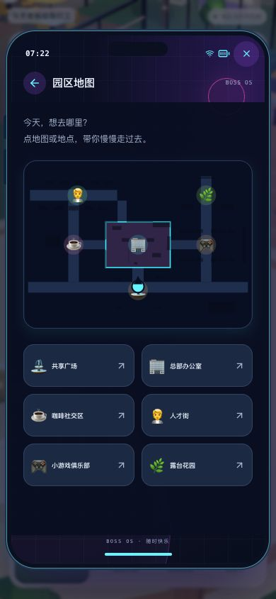
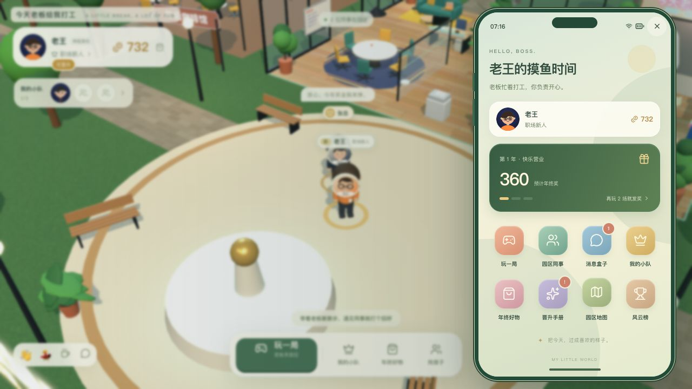
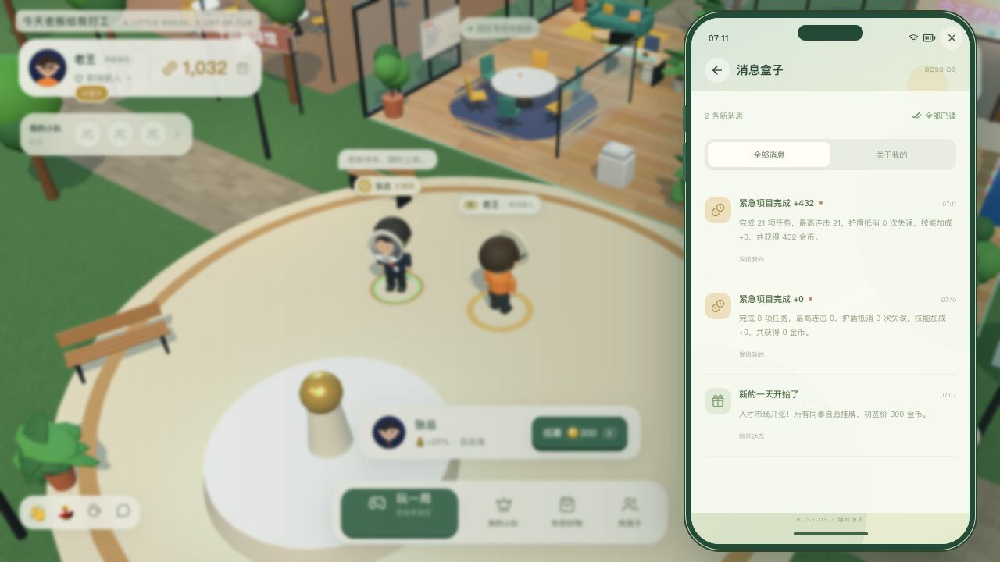
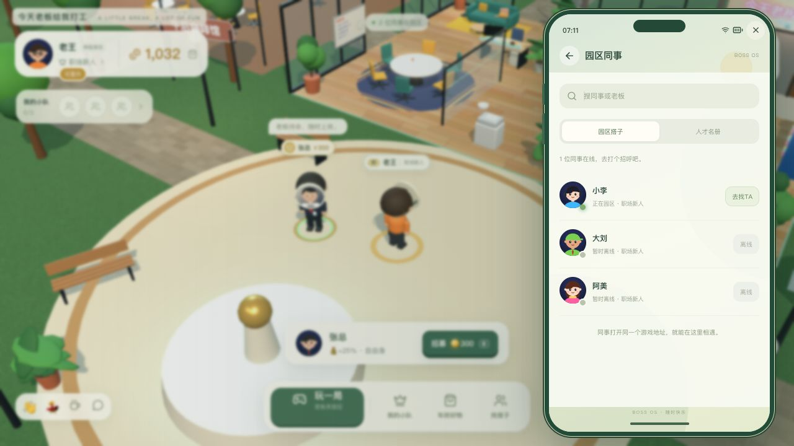
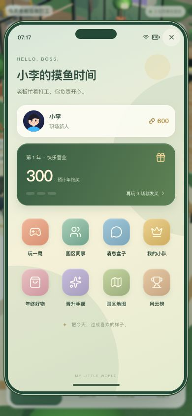
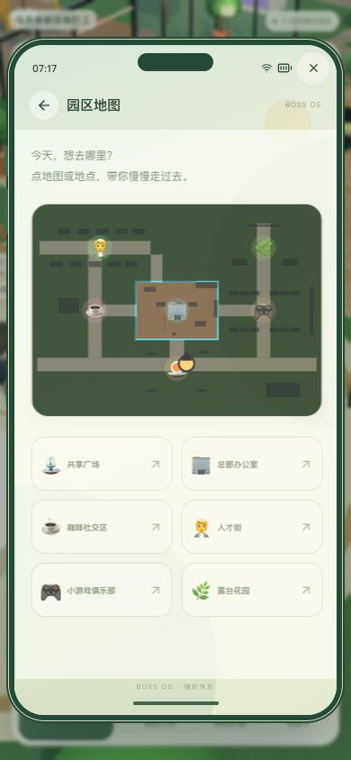
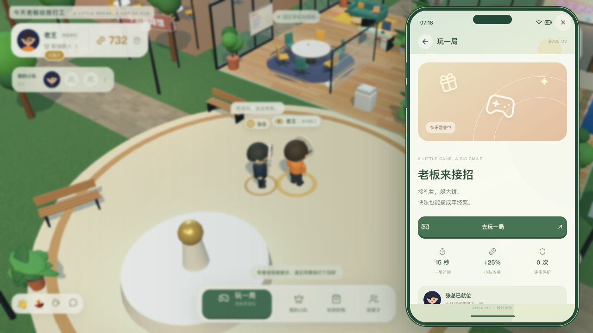

# BOSS OS 游戏内手机

园区右上角手机图标或键盘 P 打开。当前采用赛博朋克主题：午夜黑底、霓虹青/电光紫、粉紫主按钮、网格壁纸和发光应用轮廓。八个应用与实时金币/年终进度；390×844窄屏也能完整显示桌面，长内容在手机内部滚动。

## 赛博朋克配色验收

本轮仅调整手机样式与地图颜色变量，桌面、应用内页、搜索框、消息、排行、在线标记和焦点轮廓统一深色主题。手机地图采用深蓝道路与霓虹青玩家标记，园区原有小地图通过颜色默认值保持原样。

独立8791端口、独立临时数据库实机检查桌面、小游戏页、同事搜索、消息、排行与地图。开玩按钮首屏可见，点击进入原小游戏，关闭返回手机；390×844下手机370×756，完整位于视口内且无横向溢出。地图地点按钮正常收起手机并寻路。TypeScript/Vite构建及差异空白检查通过，浏览器运行错误为0；本轮配色更新未重复运行完整功能测试套件。

## 本轮范围

- 玩一局：显示真实技能与局长，进入现有单输入小游戏；退出简介或领取结算后回到原手机页面。
- 园区同事：搜索玩家和自愿挂牌的人才，显示实时在线状态，离线按钮禁用；「去找TA」收起手机并步行靠近。
- 消息盒子：真实个人消息与园区动态、筛选、未读红点和全部已读，调用已有服务端接口。
- 我的小队、年终好物、晋升手册：连接现有队伍、3D试衣间与成长面板；关闭回到手机。签约触发角色演出时让出手机返回流程。
- 园区地图：现有实时地图和六个地点，步行寻路，支持点击地图。
- 风云榜：服务端团队资产排行。

手机打开暂停移动、取消原自动路线并隔离背景操作。Tab 焦点留在手机内，页面切换重新聚焦，Esc 先回桌面再收起；搜索框输入 P 不触发收起。小游戏开玩按钮放在首屏，避免短视口被底栏遮挡。菜单中的电影片头重播与角色事件转场继续保留。

## 实机验收

测试使用独立 `127.0.0.1:8791` 和 `/tmp/boss-phone-20261020.db`，未修改普通8787环境的玩家数据。

1. 桌面实际点击打开八应用桌面，P 收起/打开。打开手机后按 D 700ms，小地图人物坐标保持 `(2.896, 9.860)`；Tab 首项为收起，Shift+Tab 绕到手机底部主页按钮。搜索输入 `pp` 后手机仍打开。
2. 从手机进入小游戏，关闭简介正确回到「玩一局」。随后完整玩两局：第一局0命中、0奖励；第二局根据可见礼物点击21次，服务器核对21命中、432金币、210成长，金币600→1,032，有效年进度0→1/3。领取结算回到手机。
3. 消息盒子显示两局实际结算，2条未读；点击「全部已读」后红点清除、按钮禁用。风云榜同步老王1,032资产、第一名。
4. 商店、晋升、小队分别进入原功能面板，关闭均回到手机桌面。
5. 第二张网页以小李登录，老王手机从0人在线更新为1人；大刘与阿美保持离线、按钮禁用。让小李移动后，通过手机「去找小李」，老王走到附近并出现碰杯交互。
6. 从手机地图选择咖啡区，手机收起，人物沿路走到 `(-15.359, 0.671)`，当前区域显示「咖啡社交区」。
7. 第二页390×844窄屏实测，页面无横向溢出，手机约370×756、完整位于视口内；八应用、地图六个地点及底部返回按钮可见。两页浏览器运行错误均为0。
8. 最终构建刷新后，完整片头自然结束。手机内直接点击地图广场图标，角色走回共享广场；再通过手机小队300招募张总，仍出现「张总，欢迎入队」角色转场。点击继续探索后手机不会抢回镜头；重新打开手机，金币732、小队1人、招募消息红点与小游戏收益+25%均更新。

构建与回归：TypeScript/Vite/Go构建通过；33项Go测试、36组规则契约、72条路径校验通过。新增一条手机交互回归脚本，现共9条Playwright验收用例；本轮执行的是上述真实网页输入验收，未执行完整Playwright CLI套件。

本轮未新增服务端协议、永久好友或私信能力。同事与消息使用现有身份、在线同步、资产和交易数据。

以下为手机系统首次交付时的功能验收图片，采用初版配色，未经重绘：

