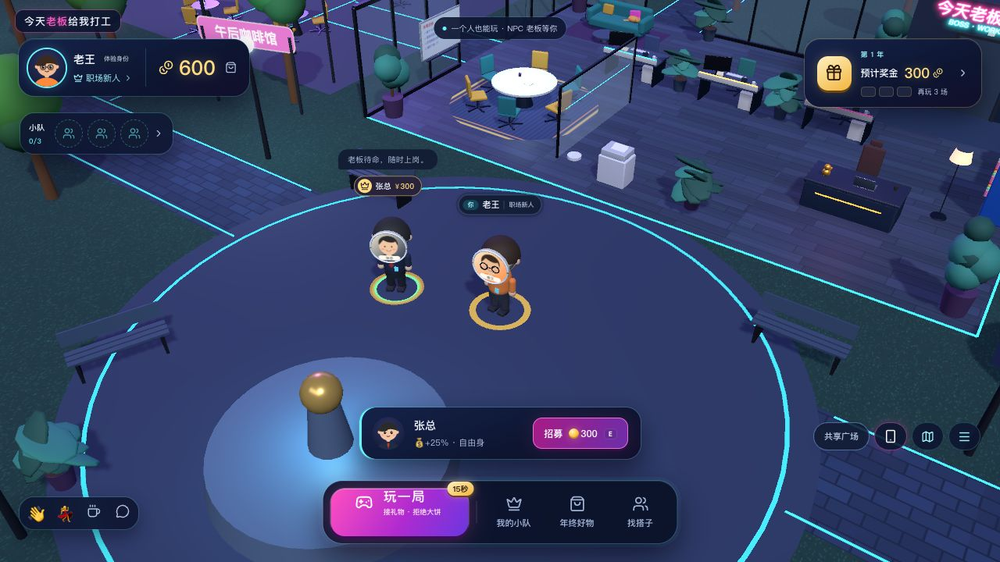
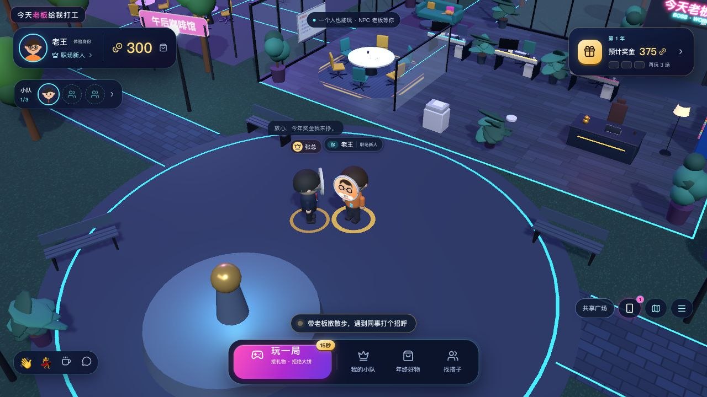
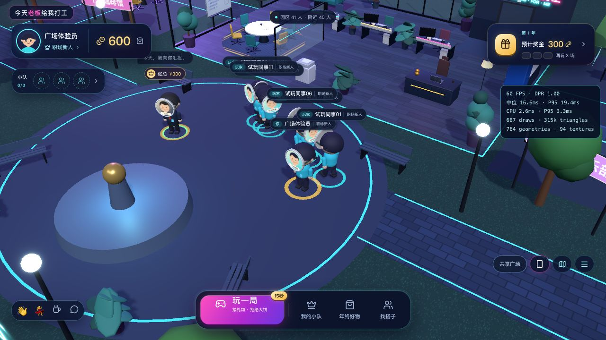
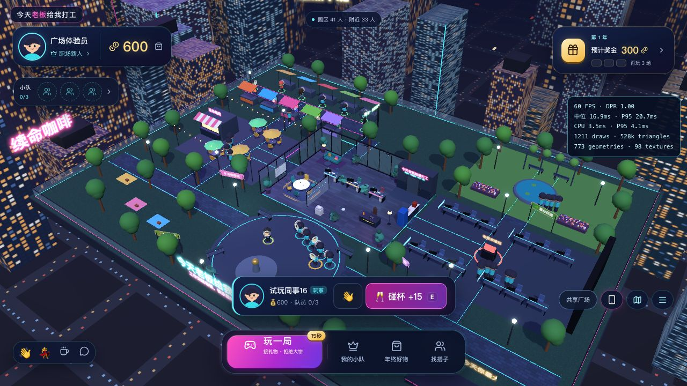
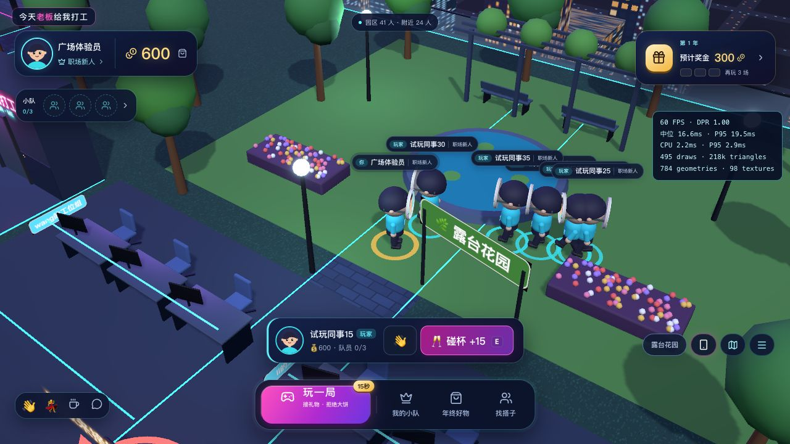
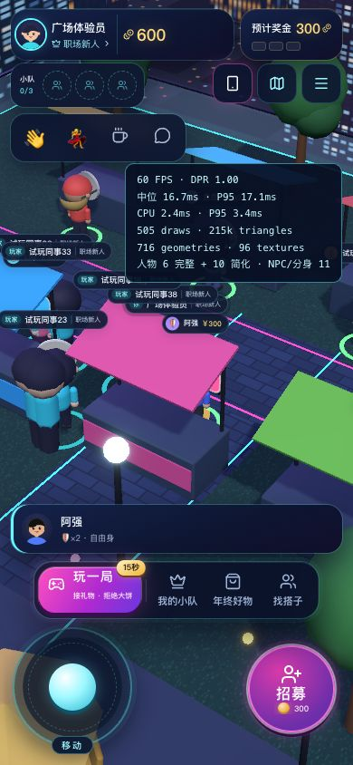
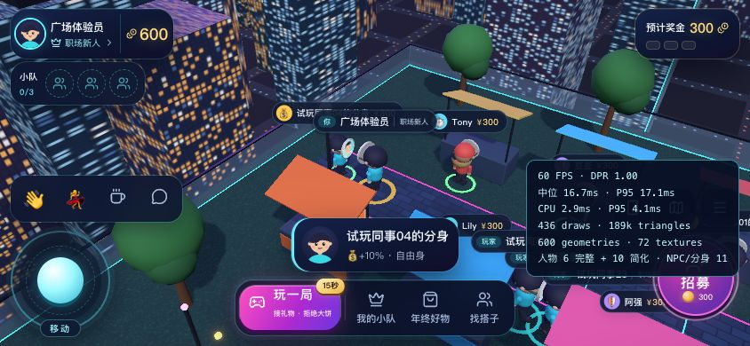

# 共享园区距离视野与单人 NPC 验收

2026-10-20。保留赛博卡通园区和原有NPC、小游戏、晋升经济；实现同图按距离订阅与人物分级。没有新增运行时依赖、图片或公司身份协议，内网SPI组装方式保持兼容。

## 实际行为

| 项目 | 本轮实现 |
| --- | --- |
| 同一张地图 | 仍是同一园区，不按部门/坐标切换房间；距离决定附近人物订阅 |
| 服务端视野 | 10米网格检索；26米进入、30米离开，边界保留带减少反复出现/消失 |
| 密集人群 | 每客户端最多订阅64位其他玩家，加自己共65位；距离排序与保留偏置；明确选中的联系人优先 |
| 找人 | 手机/搭子列表使用全园区在线状态；视野外不会被标成离线。选中联系人调用认证后的focus接口，定位并保留60秒，随后真实步行前往 |
| 同步频率 | 每200ms统一批处理；12米内最高5Hz、12–22米最高2.5Hz、更远最高1Hz，闲置时降低空转与发包 |
| 数据一致性 | 新版SSE首次全量视野，之后upsert/removal增量；重连重置。慢消费者世界位置使用独立的最新包邮箱，丢包合并时改发全量视野恢复，不挤占经济事件队列 |
| 首登/定位竞态 | 实时流开始后，迟到的HTTP初始化快照不能覆盖成员列表；联系人定位为独立upsert，不用时间戳丢弃有序SSE增量；首次取得位置后才上报移动 |
| 近处人物 | 桌面最多12位完整远端人物；窄屏/触屏最多6位，保留头像面具和动作，12/14米层级保留带 |
| 中远处人物 | 桌面最多48位、窄屏/触屏最多28位简化真实玩家，四组实例化绘制，无独立骨架、头像纹理、阴影和名牌；点击可提升为完整人物并走近 |
| 人数展示 | 全园区在线、物理附近人数、位置订阅预算分开；密集人群即使只订阅64位，附近人数仍统计实际人数；NPC不冒充在线员工，远处被定位的人不会增加“附近”计数 |
| 出生点 | 四个原有演示账号保留位置，新身份分散到广场多个安全出生点 |

旧SSE客户端未带 `world=2` 时收到附近范围的完整列表，新客户端支持增量。建议前后端一起更新。位置仍由服务端验证地图范围、更新频率及移动距离，碰杯仍由服务端校验在线、距离与冷却，经济交易继续使用原有原子事务。

## 保留单人可玩性

七位原创NPC保留：张总、Lily、阿强、小樱、钱多多、Tony、豆豆。自由身仍在广场/人才街招募；自己的队员保留跟随、技能和空间演出。被其他在线玩家带往视野外的NPC暂停实例化，NPC本身与招募归属继续存在；主人离线时仍按原设计回工位。

员工分身目录不会决定场景模型数量：常规只预览4位自由身员工，附近其他队伍最多4位代表；手机选中的分身按需出现。自己完整三人小队保留，被挖走的队员保留9秒离场窗口，演出对象继续被保留。打开招募确认会提前保留对应模型，避免目录里的角色签约后没有入职演出。未实例化的分身仍能从目录定位和招募。

单人时无需真人搭子即可完成“招募NPC→小游戏→成长→晋升→年终奖→商店”；碰杯加成继续属于额外多人奖励，不成为主循环前置条件。保留NPC说话、挥手、跟随、签约与挖角逻辑。

## 浏览器实际操作

独立8804端口/临时演示数据库，只有一个玩家在线：

- 场景实际存在全部7位NPC，另保留3位其他演示账号的分身；自己的重复自由身分身不占一个场景模型。
- 600金币招募张总，余额300，实际出现“张总，欢迎入队”和技能激活演出。
- 三局分别真实接住1/2/3次礼物，服务端结算10/22/37金币，累计60成长；首年奖金381到账，余额750。
- 实际晋升项目专员，第二年预计奖金585；全过程没有其他真人玩家、没有改数据库或伪造结算。

独立8805端口/假SPI与临时数据库，40个HTTP/SSE测试玩家沿真实地图路径散步，另有1个浏览器玩家：

- 网页显示全园区41人，附近数量随位置变化；从广场前往露台，再从列表定位“正在园区散步”的远处同事并步行到人才街，看到不同的完整人物。
- 桌面完整远端人物不超过12；390×844下完整远端人物6位，另有简化人物。实际摇杆按住800ms，释放后active样式清除。
- 390px文档宽度等于视口宽度；844×390横屏同样使用移动端6完整人物预算，摇杆/互动键保留，无横向溢出；手机、搜索和“去找TA”路径正常。
- 搜索原本未实例化的“试玩同事40的分身”，点“去找TA”后按需出现，NPC/分身模型由11增至12，40个员工没有全部生成模型。
- 浏览器运行时错误日志为空；行走夹具在首次入场及集中处理时收到过429节流，后续循环重试继续行走。视口测试不是实体低端手机测试，测试NPC/员工身份均为本地假资料。

## 验证与负载

`npm run test:web`包含新增7项附近视野/增量/目录预算/首登竞态契约检查；TypeScript和生产前端构建通过。Go完整测试、竞态检查、vet通过；新增服务端检查覆盖距离进入/离开、保留带、密集人群上限、联系人保留、增量删除、慢客户端恢复和旧客户端完整列表。

`TestCrowd100Burst`通过真实HTTP登录100个假身份、保持100条SSE、并发获取100份经济快照、同时移动并验证状态收敛。此次留档约1.04秒完成登录至移动收敛，位置订阅最多65人。日志见 [100客户端测试](../artifacts/proximity/http-sse-load.txt)。

另有100/300人分散/密集位置同步CPU基准，[原始结果](../artifacts/proximity/sync-benchmark.txt)。留档CPU基准执行时仍有网页与40个行走夹具的并行负载。该基准不包括真实公司SSO、100/300个物理浏览器、反向代理和现场Wi-Fi，不能当作生产承载人数承诺。快照查询同时改为批量读职级/穿戴并预聚合团队，减少集中登录时的逐人查询与目录反复扫描。

```sh
make test-crowd   # 仅Go，100个假身份的HTTP/SSE与AOI检查
make bench-crowd  # 仅Go，100/300人同步CPU基准
make test-api
make test-web
```

桌面/手机视口的现场采样保存在 [桌面](../artifacts/proximity/performance-desktop.json)、[手机](../artifacts/proximity/performance-mobile.json)。本机移动中约58–60 FPS，不能外推所有硬件；手机视口样例为60 FPS、6完整+10简化、11个NPC/分身。手机打开后后台园区约30帧是已有的主动限帧策略。

本轮没有实现多进程园区、自动分线或全公司目录分页。当前是单进程Go+SQLite，位置按距离分发，员工目录和经济快照仍为全服数据；更大正式规模需要继续基于内网机器与实际员工数压测。原8787服务及其数据库保留，测试服务独立运行后关闭。

## 截图











