# UI 与移动操作验收 · 2026-10-20

本轮由本机 Claude Opus 5.5 负责移动 HUD 的 UI 设计与实现，Codex 负责代码 review、小游戏修正和浏览器验收。通过 Orca 协调，Claude 完成后已停止本轮工作；五小时窗口用量从19%到23%，未超过用户要求的50%总量上限。

## 最终改动

- 青色左摇杆与霓虹紫右互动键，支持招募、挖角、碰杯和开玩；复用原来的互动事件与交易接口。
- 窄屏或粗指针设备显示操作区；窗口变化、横竖屏切换即时生效。手指捕获仅跟踪自己的 pointerId，松手、取消、失焦、切后台、卸载均将移动输入归零。摇杆拇钮直接更新 DOM 位移，不逐帧触发 React 渲染。
- 手机竖屏把菜单放在拇指上方，横屏放在两手之间；使用 safe-area inset，触控按钮至少44px。手机/抽屉/确认/小游戏/电影/聊天输入等覆盖时收起拇指区。打开手机同时清空键盘与自动寻路输入。
- Codex 修正「玩一局」卡片统一旋转-5°、结算徽章旋转-7°；清除旧负 margin，进入接住区放大时保留 translate 居中，不再突然下跳。实测进圈与未进圈卡片的中心 Y 坐标一致。
- 修正844×390横屏小游戏上下被裁切：压缩间距与传送带高度，完整显示计时和接住键；结算区域可滚动。
- 无新增依赖、3D 灯光或后期效果；保留原有电影与签约转场。

## 实测证据

生产构建，应用内 Chromium 浏览器，独立8792服务与临时数据库。没有重置原有8787服务或玩家数据。

| 验收项 | 结果 |
| --- | --- |
| 390×844、360×780竖屏 | 摇杆、互动键、菜单、聊天与手机入口完整且互不重叠 |
| 844×390横屏 | 两侧拇指区与中间菜单完整；小游戏按钮底边334.75px、面板底边349.75px，均在390px视口内 |
| 1280×720桌面 | 不显示触控区，WASD移动与空格接住礼物正常 |
| 真实按住摇杆2秒 | 服务端坐标从(0,11)变为(7.24,5.79)，松手后停止并持续稳定；[采样](../artifacts/claude-ui/movement-samples.json) |
| 手机与签约确认 | 操作区卸载；关闭后恢复；触控招募张总成功，600→300金币、小队0→1、预估年终奖300→375，入职电影出现 |
| 小游戏 | 手机点击接住、桌面空格接住均有命中；服务端显示「结算已核对」、10金币与10成长值 |
| 对齐 | 390×844卡片中心Y均447.8125；844×390卡片中心Y均207.34375；变换矩阵无旋转项 |
| 自动检查 | TypeScript与生产构建通过；Go测试、36组规则契约、72条地图路线、8项渲染检查通过；git diff --check通过 |

浏览器未发现运行时错误，已有依赖的 Three.Clock 弃用警告仍在。本轮使用浏览器视口模拟与真实指针/键盘输入，未在实体 iOS/Android 上验证双指同时操作、系统中断或刘海安全区；没有把模拟测试当作手机硬件性能测量。

## 截图

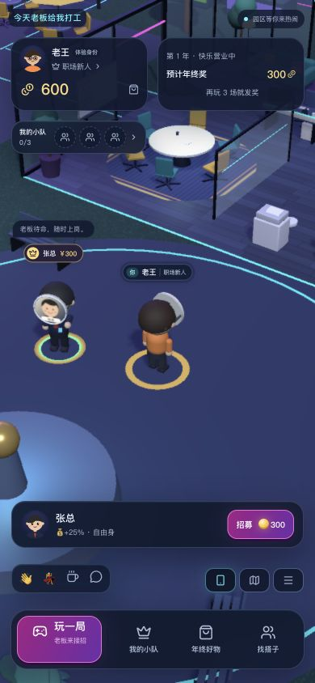
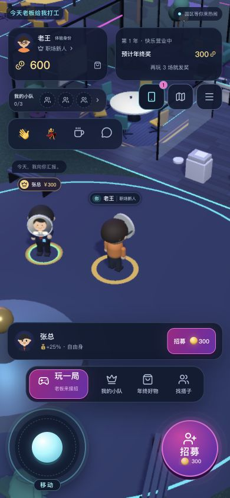
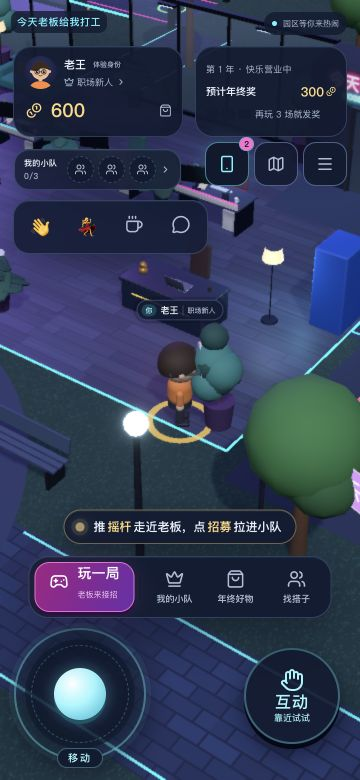
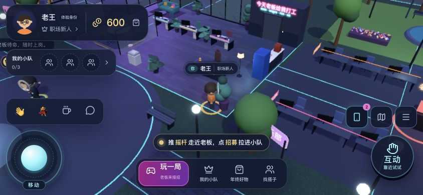
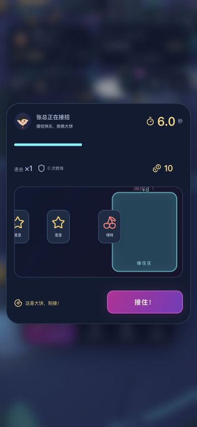
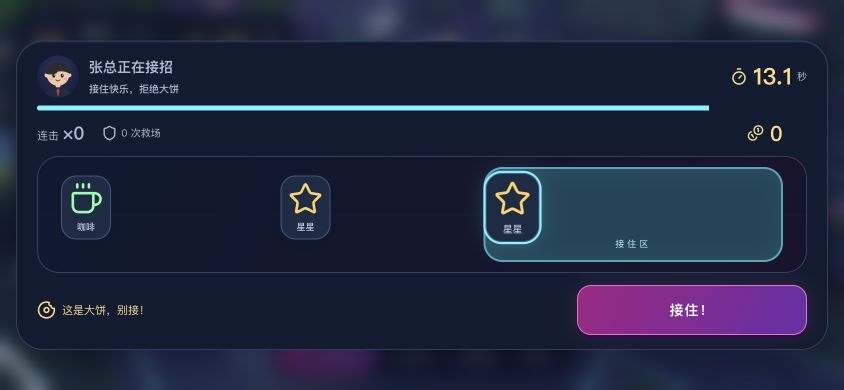
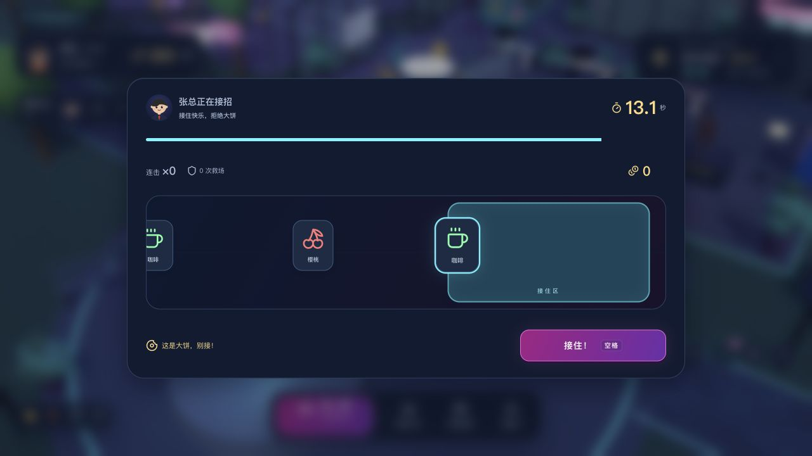
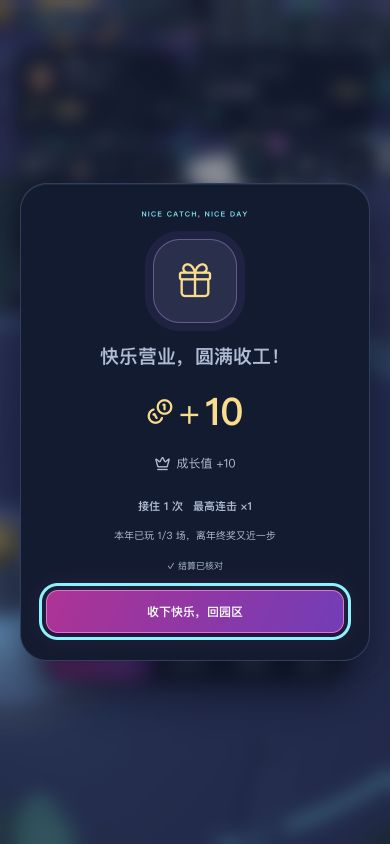

## 第二轮：主界面视觉精修与聊天操作

继续恢复同一 Claude Code 会话完成一轮有限的 UI 实现；本轮五小时总用量从23%到25%，没有启动其他 Claude worker。Claude 负责霓虹面板、金色金币/奖金层次、主按钮的品红渐变与动态时长角标，以及更精简的顶部文案；Codex 负责以下验收修正和交互实现。

- 修正旧手机样式残留的91px高度、竖排钱包与100%宽度金币按钮，明确钱包/奖金卡56px高、第一行底边66px，第二行从70px起。360×780下测试999,999金币：钱包右边228px，金币右边220.75px，无溢出；随后恢复临时测试数据。
- 奖金仍标记「预计奖金」，避免把未结算预估值当成到账余额。年终奖进度继续来自服务端。
- 触屏互动卡隐藏重复的主操作按钮，保留监听挂载，右拇指键依旧完成招募。实测张总600→300金币，小队0→1、预计奖金300→375，入队电影出现。
- 聊天增加44×44发送/收起按钮和软键盘send提示。修正旧focus-within规则在按下聊天按钮时就隐藏按钮、导致click不触发的问题；改为展开后才隐藏表情入口。空白/冷却时禁止发送，Escape可收起；收起不发送草稿，恢复摇杆。
- 地图/菜单弹层高于聊天栏；地图关闭与菜单按钮至少44px。真实点击展开地图，DOM命中检测确认关闭按钮未被遮挡。

验证：生产构建、TypeScript与git diff --check通过；现有Go测试、36组规则契约、72条地图路线、8项渲染检查通过。实际检查360×780、390×844、844×390、1280×720；桌面无触控摇杆，空格实际接住礼物，10金币与10成长值结算已核对。聊天通过真实点击开启、填写、发送后在角色头顶出现文字；再次填写草稿后点收起，输入框消失、摇杆恢复。浏览器无运行时错误。本轮没有增加3D渲染负载或重新做帧率测量；实体手机软键盘与双指仍需设备体验确认。

本轮测试仅使用8793服务及临时数据库，未修改原8787服务的玩家资产。

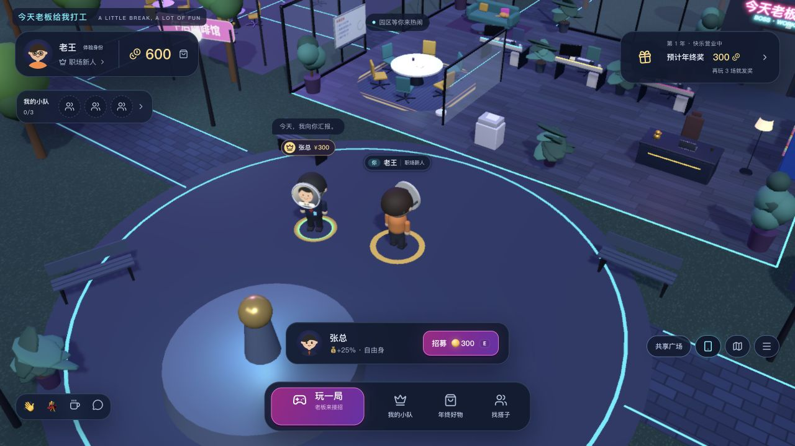
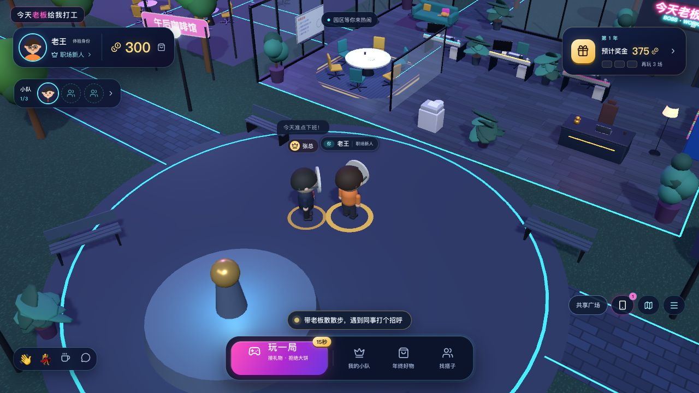
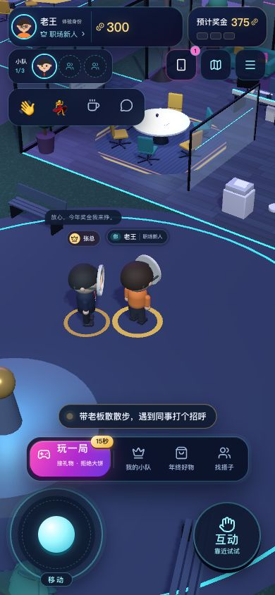
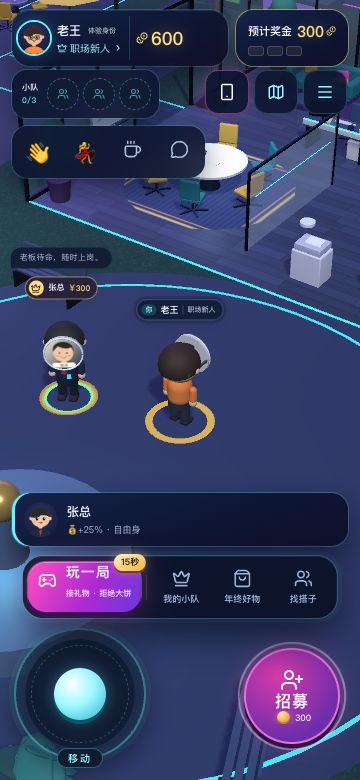
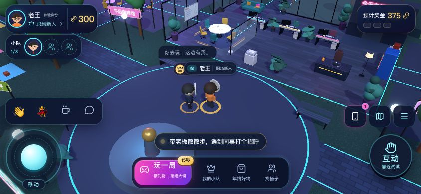
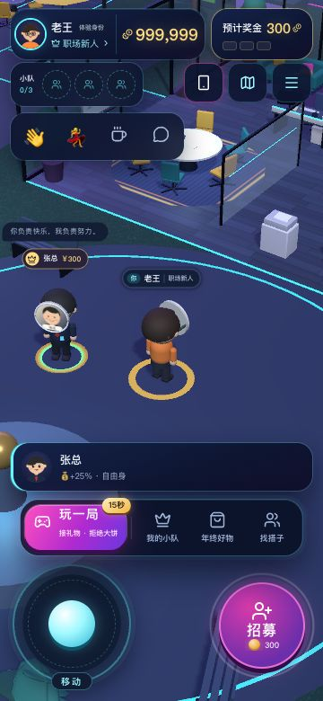
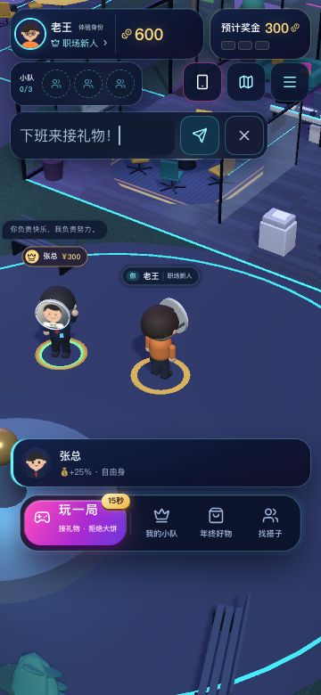
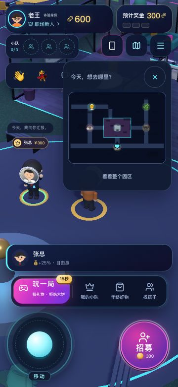

## 第三轮：游戏音效

Codex 实现 Web Audio 合成音效，未调用 Claude。默认音量35%，一个延迟创建的 AudioContext，用户首次可信点击/按键后才启用，遵循 [Web Audio 用户激活建议](https://developer.mozilla.org/en-US/docs/Web/API/Web_Audio_API/Best_practices#autoplay_policy)。不下载音频、不增加依赖；16种声音均由短音符和包络原创生成。

- 事件：按钮、手机、入场、脚步、开局、接礼物（连击升调）、主动失误、护盾、最后3秒倒计时、金币结算、签约、被挖角、年终奖、晋升、碰杯和换装。被动漏掉礼物只显示反馈，避免持续负面提示音。
- 更多菜单加入音效开关与0–100%音量；登录页可静音。设置保存在当前站点的localStorage，静音立即停止已排期音符，零音量不创建音频上下文。
- 活动音符最多24个；按类型限流；每个音符都有淡入/衰减与明确停止时间，结束断开连接。签约响应和SSE共用事件键去重；缓存最多512个事件并按时过期。切后台停止所有音符并暂停上下文，返回后用户下一次操作恢复，不补播。
- `?audio=debug`仅用于开发验收，可试听所有音效并读取状态、活动音符、实际合成信号峰值；正常游戏不创建分析器、不刷新调试面板。声音不会触发React逐帧渲染。
- 验收顺带修复桌面交易确认框被互动卡的transform/backdrop容器限制的问题：改为Portal到body。1280×720支付按钮从原来的771–815px回到458–502px；844×390横屏为293–337px。长确认内容可滚动。
- 音效菜单使用独立弹层，避免展开菜单时把地图/手机按钮推到另一位置；横屏菜单限制在12–378px且可滚动，音效按钮与滑杆均至少44px高。

验证：TypeScript、生产构建、Go测试、36组契约、72条路线、8项渲染检查和新增11项音效检查通过。音效检查覆盖延迟激活、静音/零音量、损坏存储、设备不支持/恢复拒绝、后台暂停、操作系统音频中断、重复交易、连点限流、音符上限与释放、静音中断和安全的音符包络。

真实浏览器：初始locked/0次/0音符；手势后running；签约hire计数1，实际交易与入职电影完成；16种音效逐个试听后全部有播放计数且活动音符归零，分析器记录实际非零峰值0.09493。按D行走1.4秒新增5次脚步；最终一局真实接住礼物、倒计时响3次、结算10金币与10成长值，被动漏接未增加失误音。静音时连续触发晋升和签约预览，计数保持29、音符保持0；刷新后音效仍关闭、音量仍34%。浏览器无运行时错误。

[原始DOM验收数据](../artifacts/sound/browser-checks.json)包含第一轮调音前记录与最终记录。上述证明浏览器生成了音频信号；未验证实体手机的扬声器/耳机听感或iOS来电中断，后台与设备异常由自动测试覆盖。没有添加背景音乐。测试只使用8794与临时数据库，原8787服务及玩家数据未重置。

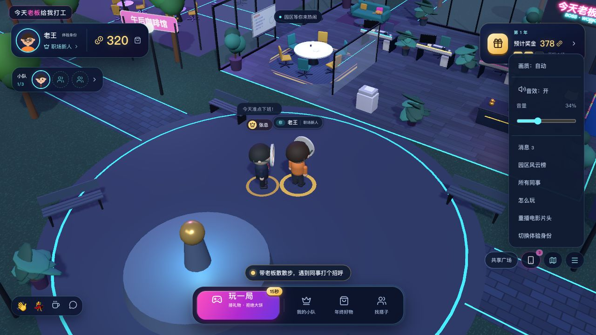
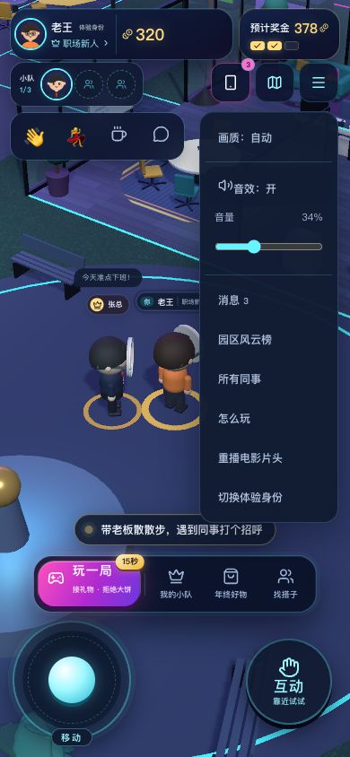
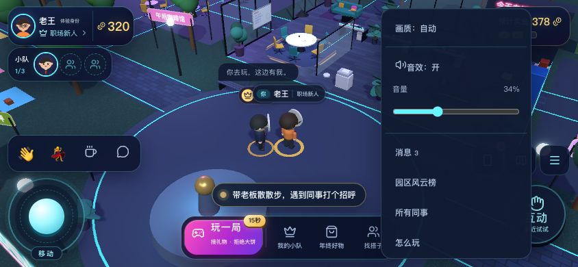
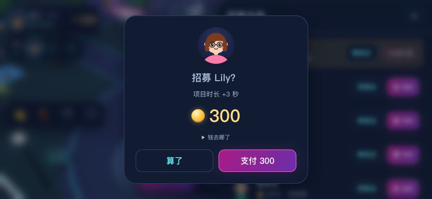
