# 游戏 UI 统一优化与验收

2026-10-20。本机 Claude Opus 5.5 负责视觉设计与实现，Codex 负责整体验收、接入和焦点/横屏修正。通过 Orca 恢复同一 Claude 会话，完成主实现与一轮 review 修正；两次任务均完成，Claude 终端已关闭。当前五小时用量从0%到8%，低于50%上限。

## 完成范围

| 界面 | 原问题 | 最终改动 |
| --- | --- | --- |
| 通用弹窗、菜单、确认与反馈 | 标题、字号、按钮状态不一致 | 深蓝面板、青色导航、品红主按钮、金色奖励；固定可见的弹窗标题，44px关闭键、48–52px主要操作；增加清晰的焦点、按下、禁用状态 |
| 晋升 | 皇冠占据首屏、双条件不清晰，未达标时只有禁用按钮 | 当前/下一职级并排，成长与有效场次独立进度；区分预计奖金和已到账；未达标可直接去开玩；横屏两栏 |
| 商店 | 手机三列过挤，商品状态和下一步不够清楚 | 彩色道具卡片、手机两列；区分穿戴中、已拥有、金币不足；列出差额、提供赚金币入口；保留3D试衣与老板换装 |
| 小队与搭子 | 信息偏小，无人在线提示未覆盖实际情况 | 统一文字层级，保留老板3D展示；依据实时在线玩家显示无人在线引导，保留离线名册与可用的同事入口 |
| 小游戏 | 说明主次弱、礼物与大饼辨识不足、横屏结算滚走标题 | 两条图标规则、明确计时与收益；彩色礼物卡和条纹虚线大饼；横屏结算双栏，标题、金币与按钮同时可见；不改输入、命中或结算规则 |
| 手机 / KIM | 浅色页辅助文字偏淡 | 保留iPhone机身、壁纸、Dock与KIM任务列表，辅助灰色调整为 `#636366`；进度与动态仍来自现有数据 |
| 帮助与键盘操作 | 八段长说明、抽屉焦点可跑到背景、Esc关闭多层 | 三步说明加可展开的操作/经济细节；抽屉Tab循环，关闭后返回菜单；嵌套确认Esc只关闭最上层 |

视觉层在 `src/ui-polish.css` 最后引入；保留现有场景、头像面具、开场和签约演出、原有API和弹窗标识。没有新增运行时图像、字体、依赖、Canvas、灯光或后期效果，也没有修改经济参数与身份SPI。

## 真实浏览器验收

生产构建，独立8800端口与临时数据库。原8787服务及玩家数据保留。检查1280×720、390×844、360×780、844×390；截图来自本轮实际网页操作。

| 项目 | 结果 |
| --- | --- |
| 手机商店 | 360px下道具名称可读；真实兑换衬衫后显示穿戴中，308→148金币；360金币道具提示还差212，开玩入口有效 |
| 晋升与领奖 | 实际三局分别命中1/5/1次，8/75/10金币、累计70成长；实际晋升项目专员，首年360金币到账 |
| 横屏晋升 | 开玩按钮在y181.9–232.9，中心命中按钮本身；进度与主要操作同屏可见 |
| 横屏结算 | 标题y71.7–96.0、按钮y264.3–316.3，均在390px内；结算面板clientHeight与scrollHeight均279，无需滚动 |
| 弹窗层级 | 从小队打开招募确认，Esc关闭确认并保留小队；真实支付300成功，签约演出触发 |
| 帮助键盘 | Tab/Shift+Tab在关闭键与末尾折叠项间循环；Esc后焦点回到更多菜单 |
| 窄屏触控 | 360/390px名册按钮均44px高、无横向溢出；商店切换与确认说明44px；从名册打开确认，Esc只关闭确认，再次Esc回菜单 |
| KIM返回路径 | KIM任务→晋升→去开玩→关闭小游戏，返回KIM；收起手机后摇杆恢复 |
| 移动操作 | 真实按住摇杆800ms，释放后active样式清除；菜单、音效控件仍可操作 |
| 错误与自动检查 | 浏览器无运行时错误；TypeScript与生产构建通过；Go测试、36组规则契约、72条路线、3项碰撞、14项渲染、2项小游戏、11项音效检查通过；diff无空白错误 |

没有另跑整套Playwright脚本；本轮通过应用内浏览器实际点击/按键验收。视口模拟不等同于实体手机的软键盘、双指或硬件性能测试。

## 性能与体积

同一浏览器1280×720静止HUD采样：前后均60 FPS；帧时间P95为19.1/18.8ms，CPU中位3.1/3.2ms，绘制调用486/485。这是单机采样，不能据此宣称所有设备性能提高。见 [改前](../artifacts/ui-unified/performance-before.json)、[改后](../artifacts/ui-unified/performance-after.json)。

生产资源gzip：CSS约22.20→24.83KB，JS约445.36→446.24KB。传送带仍使用已有RAF/translate3d，保留原有后台限帧与自适应画质。

## 截图

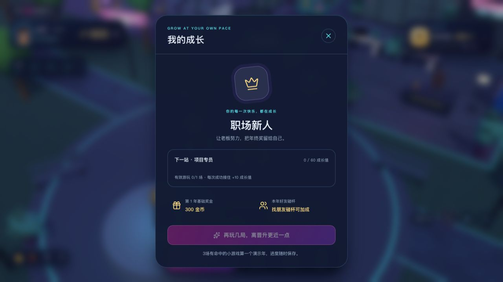
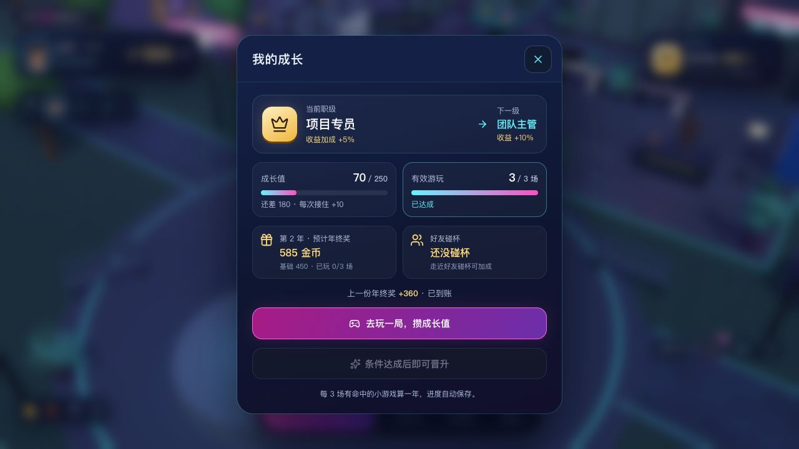
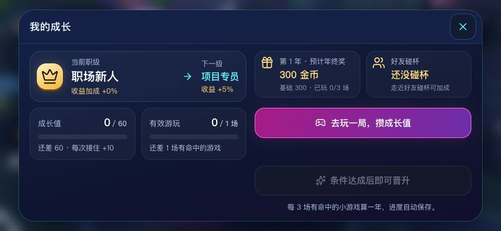
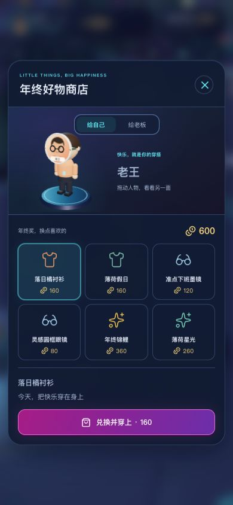
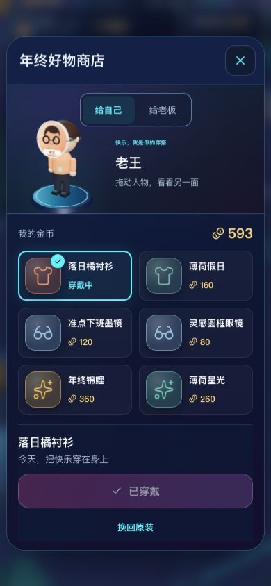
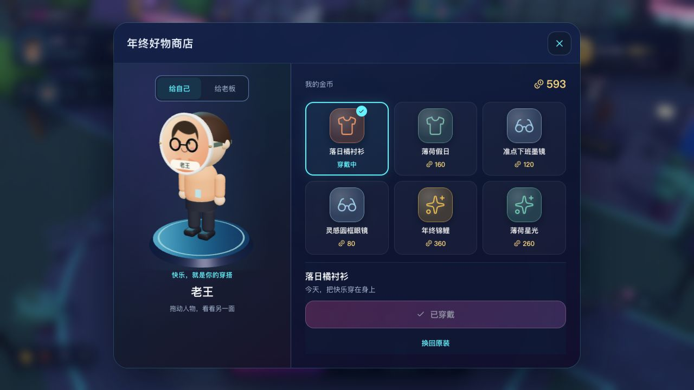
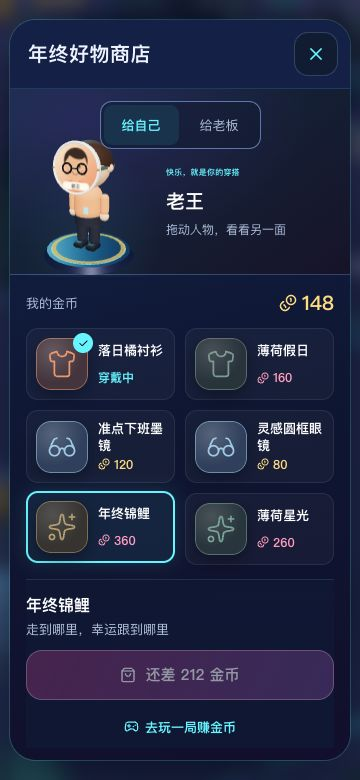
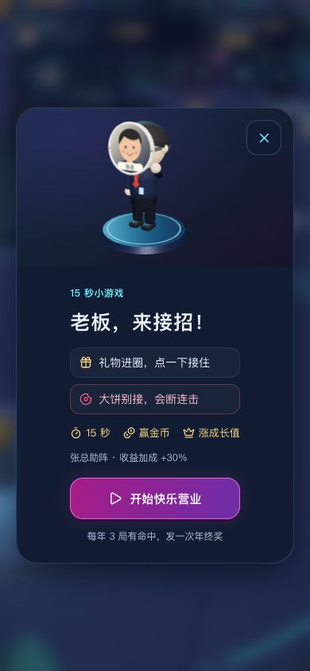
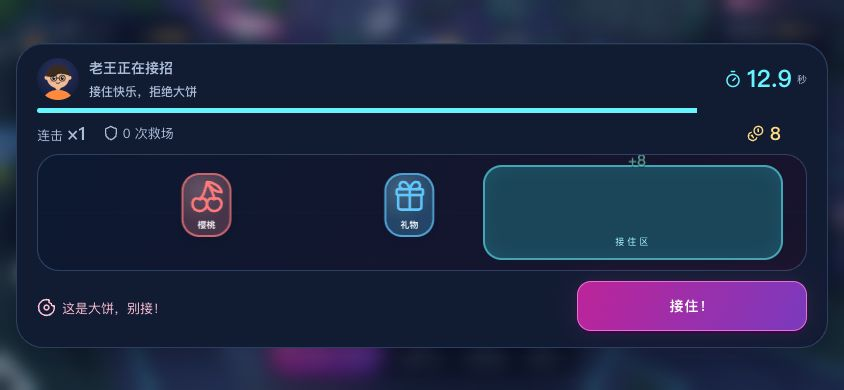
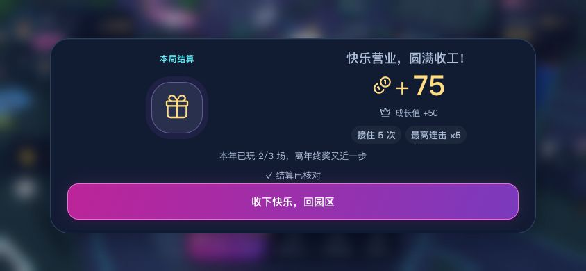
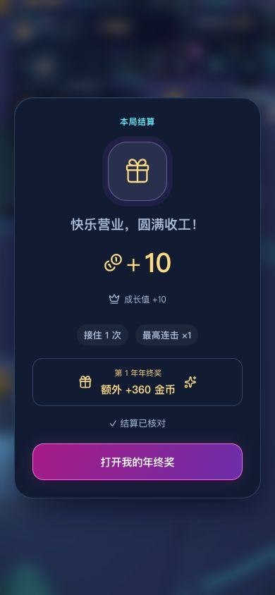
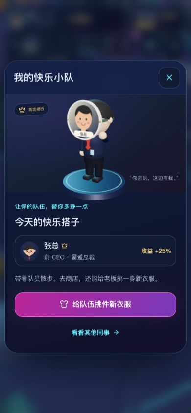
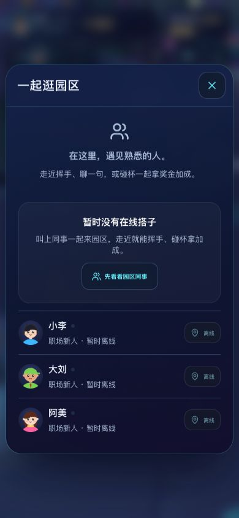
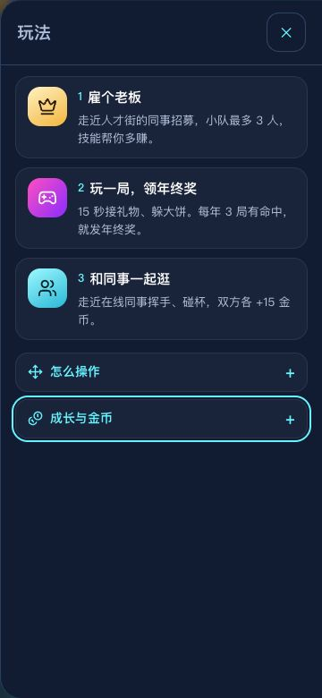
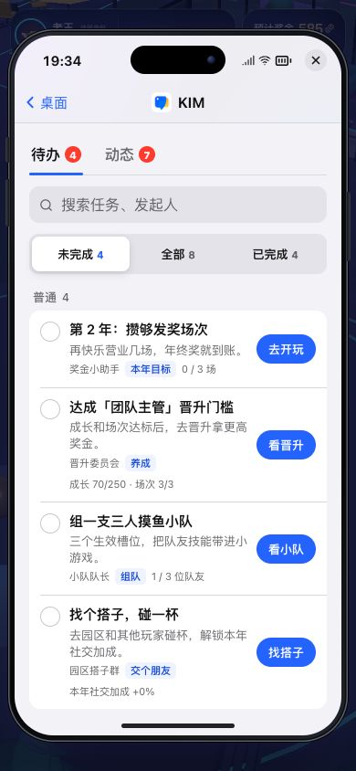
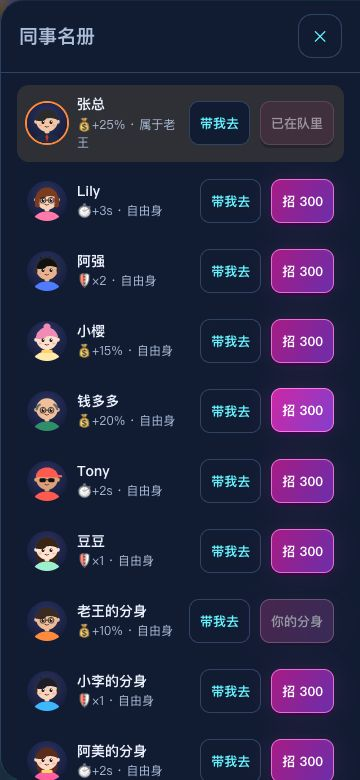
